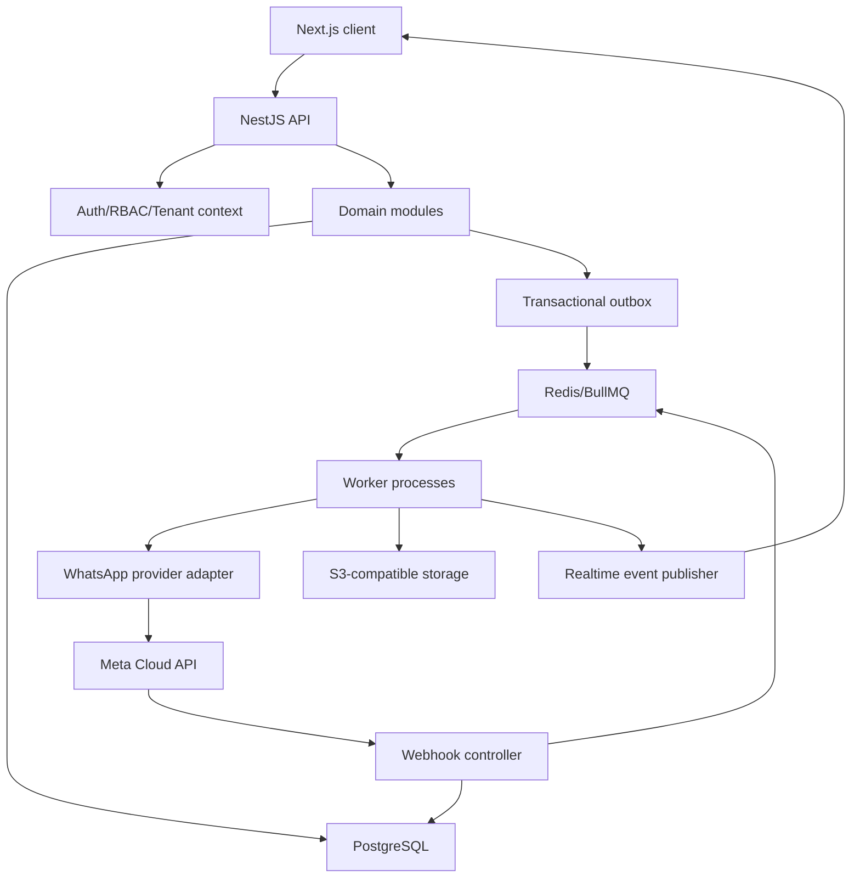
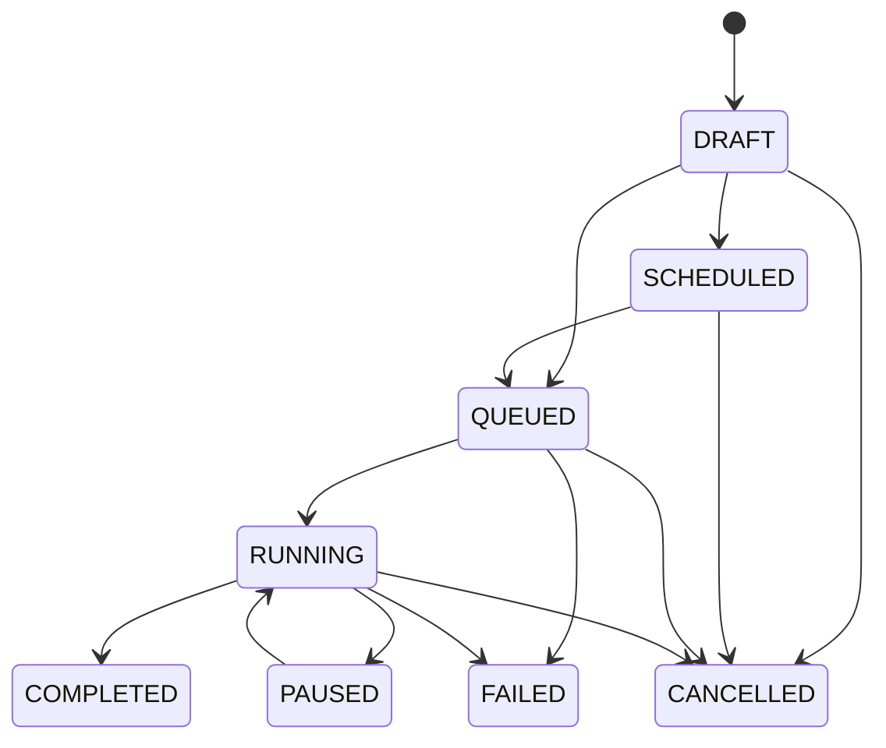

# MVP Backend and PostgreSQL Low-Level Design

TASK-091 / CLAR-081: SuperAdminController -> SuperAdminService -> SuperAdminRepository
adds authenticated partner provisioning with actor/session recheck, server-selected system
role/null tenant, no membership and atomic redacted audit. Reuse account DTO/hash/limiter;
pending partner Super Admins use the existing initial-password workflow (ADR-034). No schema
change. Contract and pending verification: docs/SUPER_ADMIN_CREATION.md.

CLAR-072 / TASK-086.8: MeController -> MeService -> MeRepository adds own-name PATCH /me
with atomic redacted audit, deriving actor/tenant from authorization. PasswordChangeController
-> PasswordChangeService -> existing credential/Auth repositories shares initial and ordinary
verification/locking/revoke-all; POST auth/change-password supports all three roles and requires
fresh sign-in. No schema change; strict handover gate remains. Contract/details: docs/PROFILE.md.

TASK-032.2: POST whatsapp/onboarding/start|complete -> EmbeddedSignupService ->
SignupAttemptRepository (Redis compare/delete) and EmbeddedSignupRepository (tenant-locked SQL).
MetaEmbeddedSignupAdapter owns fixed-host code exchange/debug/asset checks; no provider calls
inside transaction. Existing credential persistence joins the same service-owned transaction
as account upsert; no new signup table or Redis token storage. See onboarding guide/report.

ADR-031: internal ProviderCredentialPersistenceService -> ProviderCredentialRepository stores
verified credentials in an audited tenant transaction; shared ProviderCredentialService -> same
repository reads active records for API/Worker, then decrypts via ProviderCredentialCipher.
No standalone controller accepts permanent tokens. TASK-032.2 now verifies exchanged Meta
credentials/assets before the shared persistence transaction; live Meta acceptance remains pending.
Canonical provider_credentials adds encrypted_token/check, migration0010, still35 tables.

CLAR-071 / ADR-030: GET /whatsapp/onboarding -> WhatsAppOnboardingService returns safe
mode/readiness state with tenant guards. Existing WhatsAppService calls that policy before
manual-connect repository/transaction work. No persistence is needed for config projection.
Full/preview inject the same config/policy; no provider call or secret response. Embedded
completion is implemented by TASK-032.2 with the ADR-031 encrypted schema/resolver. This is
not proof of Meta approval or messaging activation; see docs/WHATSAPP_ONBOARDING.md.

CLAR-070 / ADR-029: API preview reuses existing reporting/export, WhatsApp, Template and
Campaign controllers/services/repositories without storage/email. Campaign services reject
preflight and non-review lifecycle commands before queued writes. No MessagingService,
imports, Inbox, automation or webhook module in preview; full mode unchanged. No schema change.

Status: Initial implementation baseline  
Version: 1.0  
Date: 2026-10-06  
Scope: First MVP, backend services, background workers, and PostgreSQL schema

## 1. Purpose

TASK-082.4.5.3: platform business creation is a service-orchestrated transaction across
tenant INSERT, existing-catalog tenant role/grant provisioning, Admin/membership INSERT
and audit. TenantRoleProvisioningService uses SeedRepository; PlatformRepository owns
tenant/Admin persistence. Team repository selects current tenant's active system User
role, never a global/foreign fallback. Existing authorization/schema/restore semantics
are unchanged; no implicit repair of old account assignments.

CLAR-069 / ADR-028: users.must_change_password plus restricted live authorization and
layered initial-password endpoint are defined in docs/INITIAL_PASSWORD_CHANGE.md. Login,
refresh and credential changes serialize per user; successful change atomically revokes
sessions and audits, requiring fresh login. Existing account default false; no tenant changes.

CLAR-068 / ADR-027 enables existing DB-only platform administration/insights/bounded CSV and
Tenant Admin team controllers/services/repositories in preview. No new schema/dependency or
business workflow; role/tenant checks and platform metadata-only projections remain unchanged.
This supersedes earlier blanket preview-management exclusions below.

CLAR-067 / ADR-026: protected one-time Super Admin bootstrap is documented in
FIRST_SUPER_ADMIN_BOOTSTRAP.md under docs. It requires migrations, reuses existing roles/
permissions and creates only the first platform user. All-user checks deliberately include
soft-deleted rows; table write lock, shared seed lock and completion audit prevent reopening
and concurrent initialization. No tenant/plan seeding or management expansion in preview.

Preview transport addendum (CLAR-066 / ADR-025): Next.js may proxy only /api/v1 to a fixed
private API upstream. NestJS controllers/services/repositories and auth/tenancy/cookies are
unchanged; no database change or auth logic moves into Web. See RAILWAY_LIMITED_PREVIEW.md.

This document converts the product and technical specifications in `../docs/` into an implementable low-level design for the first MVP. It defines backend module boundaries, internal execution flows, API responsibilities, queues, transactions, idempotency, security enforcement, and the initial PostgreSQL schema.

This is the implementation contract for backend, database, QA, DevOps, and security work. If code intentionally differs, the change should be recorded in an architecture decision record and reflected here.

## 2. Source documents

- `../docs/00-product-vision-and-scope.md`
- `../docs/01-functional-requirements.md`
- `../docs/02-roles-permissions-and-tenancy.md`
- `../docs/04-system-architecture.md`
- `../docs/05-domain-and-data-model.md`
- `../docs/06-api-contracts.md`
- `../docs/07-whatsapp-provider-integration.md`
- `../docs/08-messaging-campaigns-and-webhooks.md`
- `../docs/09-inbox-and-automation.md`
- `../docs/10-security-privacy-and-compliance.md`
- `../docs/11-plans-usage-and-billing.md`
- `../docs/12-devops-reliability-and-observability.md`
- `../docs/13-testing-and-acceptance.md`

## 3. MVP boundary

Delivery overlay (CLAR-030, 2026-10-15): follow `../docs/MVP_DELIVERY_PRIORITIES.md`.
Keep this architecture, approved business invariants and existing implementation. Complete
essential workflows before advanced features or speculative scale work. Extended stress
testing is a later checkpoint, not a prerequisite for the next core feature; focused
launch-safety and representative workload verification remain required before customer use.

### Included

- Multi-tenant authentication, sessions, RBAC, and granular permissions.
- Super Admin platform authorization plus single-business Tenant Admin and Tenant User authorization.
- Plans, subscriptions, feature entitlements, and usage limits.
- Meta Embedded Signup completion hooks and WhatsApp account persistence.
- WhatsApp account, phone, and template synchronization.
- Manual contacts plus asynchronous CSV/XLSX import.
- Groups, consent, opt-out, and suppression.
- Template listing, synchronization, preview data, and validation.
- Campaign draft, audience resolution, preflight, scheduling, dispatch, and reporting.
- Queue-based outbound messaging through a provider adapter.
- Verified and idempotent webhook ingestion and processing.
- Shared inbox, conversation assignment, notes, and human replies.
- Basic automation with keyword/interactive triggers, messages, choices, assignment, handoff, and end nodes.
- Audit logs, usage ledger, operational metrics, and basic reports.

### Deferred

- Payment-gateway integration and invoicing.
- Drag-and-drop advanced automation, complex conditions, and WhatsApp Flows.
- Public customer API and customer-configurable outbound webhooks.
- AI, white-labeling, and advanced analytics.
- Microservice extraction.

## 4. Technology decisions

| Area | MVP decision |
|---|---|
| Repository | pnpm workspaces with Turborepo |
| Application boundary | Separately deployable `web`, `api`, and `worker` applications |
| Frontend | Next.js App Router and TypeScript |
| Runtime | Current supported Node.js LTS |
| Language | TypeScript with strict mode |
| HTTP API | Dedicated NestJS REST/JSON API under `/api/v1` |
| Validation | DTO/schema validation at the API boundary |
| Database | PostgreSQL 16 or current supported managed equivalent |
| Data access | Drizzle ORM with drizzle-kit; generated/reviewed SQL migrations committed to source |
| Queue/cache | Redis and BullMQ or equivalent |
| Files | S3-compatible object storage |
| Realtime | MVP Inbox: authorized REST polling fallback (ADR-021); SSE/WebSocket/event publisher deferred |
| API docs | OpenAPI 3.1 generated from source |
| Authentication | Short-lived access token plus rotating refresh-session token |
| IDs | UUID v4 initially; ULID is acceptable if selected consistently |
| Time | `timestamptz`, stored in UTC, displayed in user timezone |
| Deployment | API process plus independently scalable worker processes |
| MVP hosting | Railway Pro, one project with separate web/API/worker/scheduler services |
| Managed data | Railway PostgreSQL/Redis over private networking; private S3-compatible Bucket via its issued HTTPS endpoint |
| Capacity target | 1,000-1,200 registered/daily users; plan for 100-300 concurrently active users |

PostgreSQL is the source of truth. Redis is never the sole store of business state.

Next.js is not the primary business backend. It may contain rendering logic and thin browser-facing adapters, but authentication policy, tenant authorization, persistence, provider integration, webhook processing, campaigns, messaging, and automation belong to NestJS. Python is reserved for a later specialized AI or data-processing service and is not required for the core MVP.

## 5. Runtime architecture

Test-only overlay CLAR-065 / ADR-024: API APP_MODE=preview validates only core config and
registers existing auth/session/Contacts/Groups plus health. No storage/provider/queue-producing
feature controllers/providers or webhook ingestion. Workers use the full loader and reject
preview. /me includes safe deployment_mode for UI composition; tenant/role/session guards and
Secure/Strict cookies are unchanged. No schema changes. Full/local defaults remain below.
See ../docs/RAILWAY_LIMITED_PREVIEW.md for exact scope and pending validation/domain gates.



### Deployable processes

1. `api`: synchronous REST, authentication, authorization, validation, query endpoints, and webhook receipt.
2. `worker-messaging`: outbound sends, retries, rate/concurrency control, and reconciliation.
3. `worker-events`: webhook event processing, inbox updates, status transitions, usage, and automation triggers.
4. `worker-imports`: file parsing, normalization, validation, deduplication, and batched writes.
5. `worker-scheduler`: due campaigns, delayed automation actions, outbox relay, and maintenance jobs. These may initially share one worker deployment but must use separate queues and concurrency settings.

### Railway service mapping

| Railway service | Process | Initial replicas | Scaling rule |
|---|---|---:|---|
| `web` | Next.js | 1 | Add replica only when measured web load requires it |
| `api` | NestJS API | 1 | Increase to 2 for availability or sustained latency/CPU pressure |
| `worker` | BullMQ consumers | 1 | Increase by queue depth and oldest-job SLO |
| `scheduler` | Due work and maintenance | Exactly 1 | Never scale horizontally without leader election |
| `postgres` | Primary database | 1 | Increase memory/storage before adding application replicas aggressively |
| `redis` | Queue/cache/locks | 1 | Increase memory before eviction or queue pressure |
| `bucket` | Imports/media/exports | Managed | Scale by stored bytes and egress |

Use Railway private networking for service-to-service, PostgreSQL, and Redis connections. Expose only `web`, the required public API routes, and the Meta webhook endpoint. Configure health checks and restart policies for every long-running application service.

TASK-082 / CLAR-042 repository preparation: root-context Docker builds and separate
consumer/scheduler entry points, without cloud provisioning. Scheduler uses the existing
CampaignExecutionService only; outbox/automation recovery/retention remain with consumers.
The combined local worker stays intact. Worker/scheduler private HTTP health uses strict
Controller-Service-Repository and the current queue adapter; readiness checks PG/Redis only,
not migrations or end-to-end processing. One configured replica alone does not prevent
replacement overlap; staging must verify singleton replacement or stop-before-start.
RAILWAY_STAGING_GUIDE.md defines the manual settings and pending owner domain/budget/cloud
evidence. Large exports are not a deployed worker queue (ADR-023).

## 6. Backend source layout

```text
apps/
  web/                       # Next.js App Router frontend
  api/                       # NestJS REST API and webhook gateway
  worker/                    # NestJS/BullMQ workers and schedulers
packages/
  contracts/                 # Shared DTO schemas and generated API types
  config/                    # Shared TypeScript/lint/build configuration
  ui/                        # Optional frontend UI primitives
libs/                        # Server-only workspace libraries
  common/
    auth/
    database/
    errors/
    events/
    idempotency/
    logging/
    tenancy/
  modules/
    audit/
    auth/
    automation/
    campaigns/
    contacts/
    conversations/
    imports/
    media/
    messaging/
    plans/
    reports/
    templates/
    tenants/
    users/
    whatsapp/
  providers/
    whatsapp/
```

Each domain module should expose application services and repository interfaces. Controllers must not access ORM models directly. Provider payload types must not escape the provider adapter.

Every backend feature uses strict Controller-Service-Repository layering:

1. `*.controller.ts` is the HTTP entry point. It handles routes, transport DTOs,
   parameters/headers, guards, response mapping, and HTTP status codes, then delegates to
   a service. It contains no persistence, business algorithm, transaction, or provider
   call.
2. `*.service.ts` owns application/business orchestration, domain decisions, calculations,
   transactions, policy and authorization checks, audit/outbox coordination, and calls to
   injected provider/storage/queue adapters. It is independent of HTTP objects and returns
   pure data or typed application/domain errors.
3. `*.repository.ts` is the only layer that uses Drizzle, database clients, ORM records,
   raw SQL, locks, and CRUD/optimized persistence queries. Optional `*.entity.ts` or
   `*.model.ts` files define persistence/domain mappings. Repositories enforce structural
   tenant and soft-delete predicates but contain no workflow or permission decisions.

NestJS constructor injection wires Repository -> Service -> Controller. Dependency flow is
Controller -> Service -> Repository; repositories never call outward, and controllers or
queue processors never inject repositories. A service initiates a transaction through an
injected transaction boundary and supplies the transaction context to repositories when a
use case spans multiple writes. Queue processors follow the same transport-adapter rule as
controllers and call the same services. External APIs remain behind infrastructure/provider
adapters coordinated by services, so Meta-specific payloads do not leak into services or
repositories.

Browser-safe packages and server-only libraries must be separated through package exports and build rules. Database code, secrets, and provider clients must never be imported by `apps/web` client components.

## 7. Common request lifecycle

1. Edge/WAF accepts HTTPS request.
2. API assigns or validates a request ID.
3. Authentication guard resolves user and session.
4. Tenant-context guard resolves active tenant and scoped access.
5. Permission guard checks the operation.
6. DTO validation normalizes and validates input.
7. Application service applies business, plan, quota, and policy rules.
8. Repository performs tenant-scoped reads/writes in a transaction where required.
9. Audit and outbox records are written in the same transaction for critical changes.
10. Response mapper removes internal and sensitive fields.
11. Structured log records result, latency, request ID, tenant, actor, and error code.

Never accept `tenant_id` from a request body as authorization evidence.

The implemented database foundation is `apps/api/src/database/`: a bounded node-postgres
pool, typed Drizzle client, graceful shutdown lifecycle, injectable transaction manager,
and outbox repository. The outbox insert requires an explicit transaction so application
services can guarantee aggregate state and its durable event commit atomically. The API
readiness service performs a minimal database round trip. Migration execution is a
separate controlled command and is not coupled to API process startup.

## 8. Module design

### 8.1 Authentication and sessions

`AuthService` validates email/password, user status, tenant status, optional 2FA, and rate limits. Passwords use Argon2id with centrally configured parameters.

Refresh tokens are opaque random values. Only a cryptographic hash is stored. Rotation creates a replacement session row and revokes the previous token. Reuse of a revoked/replaced token revokes the token family and generates a security audit event.

Access-token claims contain only user ID, session ID, active tenant/scope reference, and short expiry. Permissions and tenant status are resolved server-side or from a short-lived cache invalidated on role changes.

The MVP access token uses HS256 with a 15-minute lifetime. A refresh family has one
configurable absolute lifetime, defaulting to 30 days; rotation never extends it. The
browser receives the opaque refresh value only in an `HttpOnly`, `SameSite=Strict` cookie
scoped to `/api/v1/auth`, with `Secure` enabled in production. Login, refresh, and logout
validate browser origins. Login uses Redis fixed-window limits by normalized email and
client IP and fails closed when Redis is unavailable. Unknown users and all rejected
credentials share the same safe `401` response. An account with 2FA enabled is denied with
`TWO_FACTOR_REQUIRED` until the approved 2FA challenge task exists.

### 8.2 Tenant and RBAC

Super Admin is the only platform role. Tenant Admin is the client/business owner, and
Tenant User is the Admin's employee, assistant, or crew member. Each active Tenant Admin
or Tenant User has exactly one active `user_tenant_scopes` membership in the MVP and
cannot switch businesses. Super Admin creates/activates the initial Tenant Admin; that
Admin manages users and permissions inside the tenant.

The first environment is initialized through the explicit `schema:seed` maintenance
command. Its thin CLI constructs `SeedService`, `SeedRepository`, the transaction manager,
and the Argon2id password adapter. The service hashes all three temporary passwords before
opening one serialized transaction; the repository alone performs Drizzle queries and
acquires the transaction advisory lock. The workflow inserts or validates the system
permission catalog, platform Super Admin role/account, tenant Admin/User roles and
accounts, single-business memberships, `MVP_INTERNAL` plan/subscription, and one redacted
audit record. Reruns preserve existing password hashes and account states, while any
identity, tenant, plan, role, membership, or subscription conflict rolls back the run.

Super Admin status is not tenant-content authorization. Super Admin may manage Admin
accounts and read approved user/account identity, role, status, tenant membership,
billing/subscription/usage, operational-health, aggregate contact/campaign/message/send
metrics, and redacted audit metadata. Super Admin cannot read contact PII/custom fields,
message bodies or conversation history, recipient-level delivery records, customer media,
raw provider payload content, content-revealing search, signed content downloads, or
detailed customer-data exports. Tenant Admin has full authorized access to its own tenant;
Tenant User has the permissions granted by that Admin.

Implement separate Super Admin query services/repositories and response DTOs
that select only allowlisted metadata and pre-aggregated fields. Do not reuse tenant
contact, conversation, message, campaign-recipient, media, webhook-payload, search, or
export DTOs. Tenant-content services require an active Tenant Admin/User principal whose
single membership matches the tenant; `isPlatformActor` must never act as a bypass. The MVP has no
break-glass content path.

Repository methods require a `RequestContext`:

```ts
type RequestContext = {
  requestId: string;
  actorId: string;
  sessionId: string;
  tenantId: string | null;
  roleSystemKey: "SUPER_ADMIN" | "TENANT_ADMIN" | "TENANT_USER";
  permissions: ReadonlySet<string>;
  isPlatformActor: boolean;
};
```

Tenant repositories reject a missing or membership-mismatched tenant context. A method explicitly marked Super-Admin-scoped may return only its documented metadata/aggregate projection; it cannot expose a tenant-content entity. Direct database administration uses separate infrastructure credentials and independent audit controls outside this request context.

`AccessTokenGuard` verifies token signature/expiry and asks `AuthorizationService` to
resolve the exact unrevoked session, active user, role, membership, tenant, and current
permission keys through `AuthorizationRepository`. `@RequirePermissions(...)` uses
all-of semantics. `@TenantContent(...)` additionally converts the request context through
`TenantScopeService`; this conversion rejects Super Admin, missing tenants, and any role
other than active Tenant Admin/User. Tenant-owned repository methods accept the resulting
non-null `TenantRepositoryContext` and still include an explicit `tenant_id` predicate.

`GET /me` returns the safe current-user/tenant/entitlement projection. `GET /me/sessions`
lists only the actor's active sessions. `DELETE /me/sessions/{sessionId}` locks a session
selected by both actor and session ID, revokes its full refresh family, and appends a
redacted `SESSION_REVOKE` audit event in the same transaction.

### 8.3 Plans and entitlements

`EntitlementService` evaluates feature flags and numeric limits. Checks occur both when resources are created and when high-impact operations execute. Campaign preflight is repeated at dispatch so an expired or suspended subscription cannot continue sending unnoticed.

Usage is appended to `usage_events`. Dashboard counters are projections and may be rebuilt.

### 8.4 WhatsApp accounts

`WhatsAppAccountService` owns tenant-to-WABA-to-phone mapping, connection status, provider credential reference, account synchronization, template synchronization, webhook subscription result, and health checks.

Secrets are stored in a secret manager. `provider_credentials.secret_ref` stores only the reference and metadata. The browser never receives a permanent provider access token.

Connection states: `PENDING`, `CONNECTED`, `DEGRADED`, `AUTH_FAILED`, `DISCONNECTED`.

### 8.5 Contacts and imports

Manual contact writes normalize phones before uniqueness checks. The MVP uses one canonical contact per `tenant_id + phone_e164`.

Import flow:

```mermaid
flowchart LR
    U["Upload"] --> V["Type, size, malware validation"]
    V --> S["Tenant-scoped object storage"]
    S --> J["Create import job"]
    J --> P["Parse and map columns"]
    P --> N["Normalize phones"]
    N --> C["Validate consent and fields"]
    C --> D["Deduplicate"]
    D --> B["Batch insert/update"]
    B --> R["Counts and row error report"]
```



Large files are streamed and processed in batches. Invalid rows go to `contact_import_errors` and are never silently discarded.

### 8.6 Templates

Templates are synchronized from Meta and stored as internal normalized components plus an optional protected provider payload reference. Internal Tenant Admin approval and Meta provider approval are separate states. User-created or materially User-edited templates start in internal `DRAFT`, may transition through `PENDING`, `APPROVED`, or `REJECTED`, and cannot be submitted to Meta or used until the exact `content_version` is Admin-approved. Admin-created/materially Admin-edited templates use `NOT_REQUIRED`. Meta `provider_status = APPROVED` remains mandatory for sending. A material User edit increments `content_version`, clears prior review fields, and returns internal approval to `DRAFT` in the same transaction.

### 8.7 Campaigns

The TASK-053 draft slice is implemented as CampaignController → CampaignService →
CampaignRepository using existing schema fields. Contacts/static Groups audience v1 and
literal/allowlisted Contact-field mappings are defined in `../docs/CAMPAIGN_DRAFTS.md`.
Only DRAFT is mutable. Row-locked version plus content-derived revision checks reject
stale material and metadata edits. Draft saving has no message/outbox/provider side effect.
TASK-054 adds version-bound asynchronous preflight runs, identifier-only outbox/BullMQ handoff,
deduplicated recipient snapshots and aggregate policy/quota estimates as documented in
`../docs/CAMPAIGN_PREFLIGHT.md`. TASK-055 implements the approval/send lifecycle in
`../docs/CAMPAIGN_LIFECYCLE.md`, with automated acceptance coverage deferred.

Campaign writes are allowed only in mutable states. Audience criteria are stored as a versioned JSON snapshot. Preflight resolves the audience and writes/replaces recipient rows before scheduling. User-created or materially User-edited campaigns require an active same-tenant Admin to approve the exact current `content_version`; Admin-authored/materially Admin-edited campaigns use `NOT_REQUIRED`. Material User changes to audience, content/template, variables, sending account, or schedule atomically increment `content_version`, clear review fields, and return approval to `DRAFT`.

Approval is optimistic and auditable: request and review commands carry the expected
`content_version`, requester and reviewer must differ, and approval stores
`approved_version = content_version`. Schedule/send endpoints and workers reload the
campaign and template and reject missing, stale, self, or cross-tenant approval before
any provider side effect.

Campaign state flow:



The final campaign state is derived from dispatch completion and recipient outcomes. Cancelling prevents unsent work; it cannot recall provider-accepted messages.

### 8.8 Messaging

All outbound paths call `MessagingService.createOutboundMessage()`. The service applies authorization, account health, consent/suppression, customer-service window/template, content, plan/quota, and idempotency checks before creating a `messages` row. TASK-050 atomically reserves usage and audit evidence with that row. TASK-051 adds an identifier-only `message.outbound.created` event to that transaction; a stale-lock-safe relay publishes one deterministic BullMQ job and atomically advances `CREATED` to `QUEUED`. Redis never receives message content or credentials. TASK-052 enables the consumer with a durable SENDING claim, normalized SENT/provider-ID acceptance, bounded retries, FAILED terminal state and restricted audited replay. API/worker share one server-only provider (ADR-019). Uncertain acceptance requires operational review. The service is an internal application boundary and has no standalone HTTP controller.

Workers lock one pending message attempt, transition it to `SENDING`, call the provider adapter, store provider message ID, and transition to `SENT` or `FAILED`. Retryable failures are requeued with exponential backoff and jitter. Permanent validation, authentication, policy, and configuration failures require action rather than blind retries.

### 8.9 Webhooks

The webhook controller reads the raw body and required transport headers, passes them to
`WebhookIngestionService`, and maps the service result to the provider response. The
service validates `X-Hub-Signature-256`, validates the envelope, calculates the provider
event key, and coordinates transactional persistence through `WebhookEventRepository`
before returning quickly. Business processing is asynchronous.

Webhook event states: `RECEIVED`, `QUEUED`, `PROCESSING`, `PROCESSED`, `FAILED`, `DEAD`.

Processors are idempotent. Duplicate events must not duplicate messages, usage, notifications, or automation advancement. Out-of-order status events use a monotonic state precedence and provider timestamps.

### 8.10 Shared inbox

TASK-063 implements assignment/unassignment and append-only internal note APIs through a
dedicated collaboration controller/service and note repository. It reuses existing tables,
tenant permissions and member validation; internal operations have no provider/outbox side
effects. UUID retry semantics, redacted audit and limits are in
`../docs/INBOX_COLLABORATION.md` (CLAR-034). Inbox UI remains the separate TASK-066 follow-up.

TASK-061 implements tenant-scoped list/history/search and shared read-state/status APIs in
the dedicated Conversation Controller/Service/Repository with existing permissions and schema.
See `../docs/INBOX_API.md` and CLAR-032 for cursor, message-boundary acknowledgement and
status-only close/reopen semantics. Reply, assignment and transport features remain later tasks.

Inbound message processing resolves the WhatsApp account, tenant, contact, and open conversation. It inserts the message, updates conversation last activity/unread state, evaluates a basic automation trigger, and emits a tenant-scoped realtime event.

Human replies use the messaging service. Assignment, notes, close/reopen, and read state are audited where relevant. Internal notes are stored separately and never mapped to provider messages.

TASK-062 exposes the authorized reply route via a dedicated ConversationReplyService, reusing
MessagingService and its existing outbox/worker. New-reply status/automation guards run within
the common composer transaction after idempotent replay resolution. Actor-scoped keys and
server-derived targets prevent client routing overrides; see `../docs/INBOX_REPLIES.md` and
CLAR-033. No inbox UI, attachment support or automation handoff implementation is added here.

### 8.11 Basic automation

Phase 7 implementation follows owner-approved CLAR-038/039 and
`../docs/BASIC_AUTOMATION.md` / ADR-022. Reuse the five canonical tables and JSON contracts;
form-based authoring and pure simulation, Admin-only immutable publication, account-bound
exact keywords, one pinned active run and correlated choices. No advanced nodes/engine.
Automation services are exported server-only to thin worker adapters, following campaign
runtime reuse. Common MessagingService/provider delivery owns every outbound effect.
Run/trigger receipts, action effects and continuation outbox commit atomically; explicit
takeover/pause coordinates with provider claims and never recalls already-submitted requests.
See that permanent contract for lock order, entitlement/approval checks and recovery semantics.

The MVP supports `START`, `MESSAGE`, `BUTTONS`, `LIST`, `ASSIGN`, `CONTACT_UPDATE`, `HUMAN_HANDOFF`, and `END`. Published versions are immutable. Each run is pinned to a version.

The event worker locks the automation run, evaluates the current node, persists next state, and creates idempotent side effects. Human handoff changes the run to `HANDED_OFF` and prevents further automatic replies unless a defined resume/new-run rule applies.

### 8.12 Audit and reports

Security-sensitive and material business actions create append-only audit records. Reports query tenant-scoped source tables or asynchronously maintained projections. Exports become jobs when large.

TASK-080 / CLAR-040 implements on-demand direct read projections without a new cache/table.
Tenant and platform services/repositories are separate; the latter returns allowlisted
aggregates/billing/audit metadata only. Browser screens and API permissions/periods/fields
are defined in ../docs/ESSENTIAL_REPORTING.md. Reuse the reservation ledger and manual-payment
write path, never infer charges or activate subscriptions from recorded money. Automated
acceptance remains pending the phase checkpoint.

TASK-081 / CLAR-041 / ADR-023 adds direct CSV downloads bounded to 10,000 data rows and
10 MiB. Reuse these reporting services; tenant-only recipient projection requires campaign
and Contact read/export permissions. Platform exports remain aggregate/metadata only. Fully
serialize, enforce bounds and persist redacted preparation audit before raw CSV response;
never truncate. No stored files or export queue implemented. Large exports fail explicitly
and remain deferred until a separately approved durable/private-storage design. See
../docs/REPORT_EXPORTS.md for routes, fields, formula protection and deferred acceptance.

## 9. API implementation contract

### Core endpoint groups

| Group | Endpoints |
|---|---|
| Auth | `POST /auth/login`, `/auth/refresh`, `/auth/logout`, `GET /me` |
| Contacts | `GET/POST /contacts`, `GET/PATCH/DELETE /contacts/{id}` |
| Imports | `POST /contacts/imports`, `GET /contacts/imports/{id}` |
| Groups | `GET/POST /groups` |
| WhatsApp | `GET /whatsapp/accounts`, `POST /whatsapp/connect`, `POST /whatsapp/accounts/{id}/sync`, `DELETE /whatsapp/accounts/{id}` |
| Templates | `GET /templates`, `POST /templates/sync` |
| Campaigns | `GET/POST /campaigns`, `POST /campaigns/{id}/preflight`, `/send`, `/schedule`, `/pause`, `/cancel`, `GET /campaigns/{id}/report` |
| Inbox | `GET /conversations`, `GET /conversations/{id}`, `POST /conversations/{id}/messages`, `/assign`, `/close` |
| Automation | `GET/POST /automations`, `PATCH /automations/{id}`, `POST /automations/{id}/test`, `/publish`, `/pause` |
| Operations | `GET /dashboard`, `/reports`, `/audit-logs`, `/usage` |
| Provider | `GET/POST /webhooks/meta/whatsapp` |

### Response envelope

```json
{
  "data": {},
  "request_id": "req_01..."
}
```

### Error envelope

```json
{
  "error": {
    "code": "CONTACT_OPTED_OUT",
    "message": "The contact cannot receive this marketing message.",
    "request_id": "req_01...",
    "retryable": false,
    "details": []
  }
}
```

Error codes are stable API values. Logs may contain safe diagnostic context; responses must not include stack traces or provider secrets.

### Idempotency keys

Required on campaign send/schedule, manual outbound reply, and any endpoint that can create expensive or duplicate side effects. The stored scope is tenant, actor/client, method, route, key, and request hash. Same key plus same hash returns the stored response; same key plus different hash returns HTTP 409.

## 10. Queue design

| Queue | Job | Concurrency scope |
|---|---|---|
| `outbox-relay` | Publish committed domain events | Global controlled |
| `campaign-scheduler` | Activate due campaigns | Singleton/leader lock |
| `campaign-expand` | Create recipient send work | Per tenant/campaign |
| `message-send` | Send one outbound message | Per tenant and phone number |
| `webhook-process` | Process persisted provider event | By event partition/key |
| `contact-import` | Parse and persist one import | Per tenant/import |
| `automation-run` | Advance one run/node | Per conversation/run |
| `reconciliation` | Repair stuck/missing states | Bounded global |
| `report-export` | Generate large export | Per tenant |

Minimal job payloads contain internal IDs, tenant ID, correlation ID, attempt, and schema version. Do not place access tokens or large message payloads in Redis.

Every worker re-loads authoritative database state and re-checks tenant, object state, and relevant policy before side effects.

## 11. Transactions and concurrency

- Use a database transaction for aggregate state changes plus audit/outbox insert.
- Use `SELECT ... FOR UPDATE SKIP LOCKED` or queue-native ownership for dispatch claims.
- Use optimistic version columns where users can concurrently edit drafts. Campaign and template `content_version` also binds Admin approval to the exact material configuration.
- Campaign expansion and webhook processing must be safe to retry.
- Automation advancement requires a lock keyed by active run/conversation.
- Quota decisions requiring strict enforcement use transactional counters or reservation rows; the append-only usage event remains the audit source.
- Never hold a database transaction open while calling Meta or object storage.

## 12. PostgreSQL schema

### 12.1 Conventions

- Schema: `app`.
- Table and column names: `snake_case`.
- Primary keys: UUID with `gen_random_uuid()`.
- All timestamps: `timestamptz`.
- Mutable tables have `created_at` and `updated_at` fields.
- Approved API-deletable business tables use `is_deleted`, `deleted_at`, and
  `deleted_by` exactly as defined in
  `../apps/api/database/schema/SOFT_DELETE_POLICY.md`.
- Operational, append-only, immutable-version, and history tables use lifecycle status,
  revocation, expiry, or retention rather than a generic soft-delete flag.
- Status values use text plus `CHECK` constraints to simplify controlled additions.
- Foreign keys are indexed when used for filtering/joining.
- Tenant-owned unique constraints start with `tenant_id`.

### 12.2 Historical initial DDL (superseded)

The block below is retained only as the original design record. It is **not** the current
implementation contract and must not be copied into migrations. The approved current
schema is `../apps/api/database/schema/`:35 separate per-table SQL files, `manifest.json`, the
relationship map, and the soft-delete policy. Matching Drizzle definitions are maintained
in `../apps/api/src/database/schema/`, with the generated and reviewed migration in
`../apps/api/database/migrations/`; `pnpm schema:verify` must pass.

```sql
CREATE EXTENSION IF NOT EXISTS pgcrypto;
CREATE SCHEMA IF NOT EXISTS app;

CREATE TABLE app.plans (
  id uuid PRIMARY KEY DEFAULT gen_random_uuid(),
  code text NOT NULL UNIQUE,
  name text NOT NULL,
  status text NOT NULL CHECK (status IN ('ACTIVE', 'INACTIVE', 'RETIRED')),
  price_minor bigint NOT NULL DEFAULT 0 CHECK (price_minor >= 0),
  currency char(3),
  validity_days integer CHECK (validity_days IS NULL OR validity_days > 0),
  limits jsonb NOT NULL DEFAULT '{}'::jsonb,
  feature_flags jsonb NOT NULL DEFAULT '{}'::jsonb,
  created_at timestamptz NOT NULL DEFAULT now(),
  updated_at timestamptz NOT NULL DEFAULT now()
);

CREATE TABLE app.tenants (
  id uuid PRIMARY KEY DEFAULT gen_random_uuid(),
  name text NOT NULL,
  slug text NOT NULL UNIQUE,
  status text NOT NULL CHECK (status IN ('PENDING', 'ACTIVE', 'SUSPENDED', 'CLOSED')),
  default_timezone text NOT NULL DEFAULT 'UTC',
  default_country_code char(2),
  business_profile jsonb NOT NULL DEFAULT '{}'::jsonb,
  created_at timestamptz NOT NULL DEFAULT now(),
  updated_at timestamptz NOT NULL DEFAULT now(),
  deleted_at timestamptz
);

CREATE TABLE app.subscriptions (
  id uuid PRIMARY KEY DEFAULT gen_random_uuid(),
  tenant_id uuid NOT NULL REFERENCES app.tenants(id),
  plan_id uuid NOT NULL REFERENCES app.plans(id),
  status text NOT NULL CHECK (status IN ('TRIAL', 'ACTIVE', 'PAST_DUE', 'SUSPENDED', 'CANCELLED', 'EXPIRED')),
  starts_at timestamptz NOT NULL,
  ends_at timestamptz,
  external_customer_ref text,
  external_subscription_ref text,
  created_at timestamptz NOT NULL DEFAULT now(),
  updated_at timestamptz NOT NULL DEFAULT now(),
  CHECK (ends_at IS NULL OR ends_at > starts_at)
);
CREATE INDEX subscriptions_tenant_status_idx ON app.subscriptions (tenant_id, status);

CREATE TABLE app.roles (
  id uuid PRIMARY KEY DEFAULT gen_random_uuid(),
  tenant_id uuid REFERENCES app.tenants(id),
  name text NOT NULL,
  system_key text,
  is_system boolean NOT NULL DEFAULT false,
  created_at timestamptz NOT NULL DEFAULT now()
);
CREATE UNIQUE INDEX roles_tenant_name_uq ON app.roles (tenant_id, name) WHERE tenant_id IS NOT NULL;
CREATE UNIQUE INDEX roles_platform_name_uq ON app.roles (name) WHERE tenant_id IS NULL;
CREATE UNIQUE INDEX roles_tenant_system_key_uq ON app.roles (tenant_id, system_key) WHERE tenant_id IS NOT NULL AND system_key IS NOT NULL;
CREATE UNIQUE INDEX roles_platform_system_key_uq ON app.roles (system_key) WHERE tenant_id IS NULL AND system_key IS NOT NULL;

CREATE TABLE app.permissions (
  id uuid PRIMARY KEY DEFAULT gen_random_uuid(),
  permission_key text NOT NULL UNIQUE,
  description text NOT NULL
);

CREATE TABLE app.role_permissions (
  role_id uuid NOT NULL REFERENCES app.roles(id) ON DELETE CASCADE,
  permission_id uuid NOT NULL REFERENCES app.permissions(id) ON DELETE CASCADE,
  PRIMARY KEY (role_id, permission_id)
);

CREATE TABLE app.users (
  id uuid PRIMARY KEY DEFAULT gen_random_uuid(),
  home_tenant_id uuid REFERENCES app.tenants(id),
  role_id uuid NOT NULL REFERENCES app.roles(id),
  email text NOT NULL,
  password_hash text NOT NULL,
  display_name text NOT NULL,
  status text NOT NULL CHECK (status IN ('INVITED', 'ACTIVE', 'LOCKED', 'DISABLED')),
  two_factor_enabled boolean NOT NULL DEFAULT false,
  token_version integer NOT NULL DEFAULT 1,
  last_login_at timestamptz,
  created_at timestamptz NOT NULL DEFAULT now(),
  updated_at timestamptz NOT NULL DEFAULT now(),
  deleted_at timestamptz
);
CREATE UNIQUE INDEX users_email_active_uq ON app.users (lower(email)) WHERE deleted_at IS NULL;
CREATE INDEX users_home_tenant_idx ON app.users (home_tenant_id, status);

CREATE TABLE app.user_tenant_scopes (
  user_id uuid NOT NULL REFERENCES app.users(id) ON DELETE CASCADE,
  tenant_id uuid NOT NULL REFERENCES app.tenants(id) ON DELETE CASCADE,
  role_id uuid REFERENCES app.roles(id),
  created_at timestamptz NOT NULL DEFAULT now(),
  PRIMARY KEY (user_id, tenant_id)
);

CREATE TABLE app.auth_sessions (
  id uuid PRIMARY KEY DEFAULT gen_random_uuid(),
  user_id uuid NOT NULL REFERENCES app.users(id) ON DELETE CASCADE,
  refresh_token_hash text NOT NULL UNIQUE,
  token_family_id uuid NOT NULL,
  replaced_by_session_id uuid REFERENCES app.auth_sessions(id),
  user_agent text,
  ip_address inet,
  expires_at timestamptz NOT NULL,
  revoked_at timestamptz,
  created_at timestamptz NOT NULL DEFAULT now()
);
CREATE INDEX auth_sessions_user_active_idx ON app.auth_sessions (user_id, expires_at) WHERE revoked_at IS NULL;

CREATE TABLE app.whatsapp_accounts (
  id uuid PRIMARY KEY DEFAULT gen_random_uuid(),
  tenant_id uuid NOT NULL REFERENCES app.tenants(id),
  provider text NOT NULL DEFAULT 'META',
  business_id text,
  waba_id text NOT NULL,
  phone_number_id text NOT NULL,
  display_phone text NOT NULL,
  display_name text,
  status text NOT NULL CHECK (status IN ('PENDING', 'CONNECTED', 'DEGRADED', 'AUTH_FAILED', 'DISCONNECTED')),
  is_default boolean NOT NULL DEFAULT false,
  health jsonb NOT NULL DEFAULT '{}'::jsonb,
  last_synced_at timestamptz,
  created_at timestamptz NOT NULL DEFAULT now(),
  updated_at timestamptz NOT NULL DEFAULT now(),
  UNIQUE (provider, phone_number_id),
  UNIQUE (tenant_id, id)
);
CREATE INDEX whatsapp_accounts_tenant_status_idx ON app.whatsapp_accounts (tenant_id, status);
CREATE UNIQUE INDEX whatsapp_accounts_one_default_uq ON app.whatsapp_accounts (tenant_id) WHERE is_default;

CREATE TABLE app.provider_credentials (
  id uuid PRIMARY KEY DEFAULT gen_random_uuid(),
  tenant_id uuid NOT NULL REFERENCES app.tenants(id),
  whatsapp_account_id uuid NOT NULL UNIQUE REFERENCES app.whatsapp_accounts(id) ON DELETE CASCADE,
  provider text NOT NULL,
  secret_ref text NOT NULL,
  status text NOT NULL CHECK (status IN ('ACTIVE', 'INVALID', 'REVOKED')),
  last_validated_at timestamptz,
  created_at timestamptz NOT NULL DEFAULT now(),
  updated_at timestamptz NOT NULL DEFAULT now()
);

CREATE TABLE app.contacts (
  id uuid PRIMARY KEY DEFAULT gen_random_uuid(),
  tenant_id uuid NOT NULL REFERENCES app.tenants(id),
  phone_e164 text NOT NULL,
  name text,
  email text,
  company text,
  address text,
  source text,
  assigned_user_id uuid REFERENCES app.users(id),
  custom_fields jsonb NOT NULL DEFAULT '{}'::jsonb,
  consent_status text NOT NULL DEFAULT 'UNKNOWN' CHECK (consent_status IN ('UNKNOWN', 'OPTED_IN', 'OPTED_OUT', 'SUPPRESSED')),
  consent_source text,
  consent_at timestamptz,
  consent_category text,
  opt_out_at timestamptz,
  opt_out_source text,
  suppression_reason text,
  last_contacted_at timestamptz,
  created_at timestamptz NOT NULL DEFAULT now(),
  updated_at timestamptz NOT NULL DEFAULT now(),
  deleted_at timestamptz,
  UNIQUE (tenant_id, phone_e164),
  UNIQUE (tenant_id, id)
);
CREATE INDEX contacts_tenant_name_idx ON app.contacts (tenant_id, name);
CREATE INDEX contacts_tenant_consent_idx ON app.contacts (tenant_id, consent_status);

CREATE TABLE app.contact_groups (
  id uuid PRIMARY KEY DEFAULT gen_random_uuid(),
  tenant_id uuid NOT NULL REFERENCES app.tenants(id),
  name text NOT NULL,
  created_at timestamptz NOT NULL DEFAULT now(),
  UNIQUE (tenant_id, name),
  UNIQUE (tenant_id, id)
);

CREATE TABLE app.contact_group_members (
  tenant_id uuid NOT NULL REFERENCES app.tenants(id),
  group_id uuid NOT NULL,
  contact_id uuid NOT NULL,
  created_at timestamptz NOT NULL DEFAULT now(),
  PRIMARY KEY (group_id, contact_id),
  FOREIGN KEY (tenant_id, group_id) REFERENCES app.contact_groups(tenant_id, id) ON DELETE CASCADE,
  FOREIGN KEY (tenant_id, contact_id) REFERENCES app.contacts(tenant_id, id) ON DELETE CASCADE
);

CREATE TABLE app.contact_imports (
  id uuid PRIMARY KEY DEFAULT gen_random_uuid(),
  tenant_id uuid NOT NULL REFERENCES app.tenants(id),
  requested_by uuid NOT NULL REFERENCES app.users(id),
  storage_key text NOT NULL,
  original_filename text NOT NULL,
  status text NOT NULL CHECK (status IN ('UPLOADED', 'QUEUED', 'PROCESSING', 'COMPLETED', 'FAILED', 'CANCELLED')),
  mapping jsonb NOT NULL DEFAULT '{}'::jsonb,
  default_country_code char(2),
  total_rows integer NOT NULL DEFAULT 0,
  inserted_rows integer NOT NULL DEFAULT 0,
  updated_rows integer NOT NULL DEFAULT 0,
  invalid_rows integer NOT NULL DEFAULT 0,
  error_code text,
  started_at timestamptz,
  completed_at timestamptz,
  created_at timestamptz NOT NULL DEFAULT now()
);
CREATE INDEX contact_imports_tenant_created_idx ON app.contact_imports (tenant_id, created_at DESC);

CREATE TABLE app.contact_import_errors (
  id bigserial PRIMARY KEY,
  import_id uuid NOT NULL REFERENCES app.contact_imports(id) ON DELETE CASCADE,
  row_number integer NOT NULL,
  error_code text NOT NULL,
  error_message text NOT NULL,
  row_data jsonb,
  created_at timestamptz NOT NULL DEFAULT now()
);
CREATE INDEX contact_import_errors_import_row_idx ON app.contact_import_errors (import_id, row_number);

CREATE TABLE app.templates (
  id uuid PRIMARY KEY DEFAULT gen_random_uuid(),
  tenant_id uuid NOT NULL REFERENCES app.tenants(id),
  whatsapp_account_id uuid NOT NULL REFERENCES app.whatsapp_accounts(id),
  provider_template_id text,
  name text NOT NULL,
  language text NOT NULL,
  category text NOT NULL,
  provider_status text NOT NULL CHECK (provider_status IN ('DRAFT', 'PENDING', 'APPROVED', 'REJECTED', 'PAUSED', 'DISABLED')),
  components jsonb NOT NULL DEFAULT '[]'::jsonb,
  rejection_reason text,
  provider_updated_at timestamptz,
  content_version integer NOT NULL DEFAULT 1,
  approval_status text NOT NULL DEFAULT 'DRAFT' CHECK (approval_status IN ('NOT_REQUIRED', 'DRAFT', 'PENDING', 'APPROVED', 'REJECTED')),
  approval_requested_by uuid REFERENCES app.users(id),
  approval_requested_at timestamptz,
  reviewed_by uuid REFERENCES app.users(id),
  reviewed_at timestamptz,
  approved_version integer,
  approval_rejection_reason text,
  created_at timestamptz NOT NULL DEFAULT now(),
  updated_at timestamptz NOT NULL DEFAULT now(),
  UNIQUE (tenant_id, whatsapp_account_id, name, language),
  UNIQUE (tenant_id, id)
);
CREATE INDEX templates_tenant_status_idx ON app.templates (tenant_id, provider_status);
CREATE INDEX templates_tenant_approval_idx ON app.templates (tenant_id, approval_status, updated_at);

CREATE TABLE app.campaigns (
  id uuid PRIMARY KEY DEFAULT gen_random_uuid(),
  tenant_id uuid NOT NULL REFERENCES app.tenants(id),
  created_by uuid NOT NULL REFERENCES app.users(id),
  whatsapp_account_id uuid NOT NULL REFERENCES app.whatsapp_accounts(id),
  template_id uuid NOT NULL REFERENCES app.templates(id),
  name text NOT NULL,
  description text,
  status text NOT NULL CHECK (status IN ('DRAFT', 'SCHEDULED', 'QUEUED', 'RUNNING', 'PAUSED', 'COMPLETED', 'CANCELLED', 'FAILED')),
  audience_definition jsonb NOT NULL DEFAULT '{}'::jsonb,
  variable_mapping jsonb NOT NULL DEFAULT '{}'::jsonb,
  schedule_at timestamptz,
  schedule_timezone text NOT NULL DEFAULT 'UTC',
  template_content_version integer CHECK (template_content_version > 0),
  start_key text,
  start_hash text,
  delivery_requested_by uuid REFERENCES app.users(id),
  final_preflight_id uuid, -- Tenant-matched deferred FK in the canonical schema.
  pause_reason text,
  started_at timestamptz,
  completed_at timestamptz,
  content_version integer NOT NULL DEFAULT 1,
  approval_status text NOT NULL DEFAULT 'DRAFT' CHECK (approval_status IN ('NOT_REQUIRED', 'DRAFT', 'PENDING', 'APPROVED', 'REJECTED')),
  approval_requested_by uuid REFERENCES app.users(id),
  approval_requested_at timestamptz,
  reviewed_by uuid REFERENCES app.users(id),
  reviewed_at timestamptz,
  approved_version integer,
  approval_rejection_reason text,
  created_at timestamptz NOT NULL DEFAULT now(),
  updated_at timestamptz NOT NULL DEFAULT now(),
  UNIQUE (tenant_id, id)
);
CREATE INDEX campaigns_tenant_status_schedule_idx ON app.campaigns (tenant_id, status, schedule_at);
CREATE INDEX campaigns_tenant_approval_idx ON app.campaigns (tenant_id, approval_status, updated_at);

CREATE TABLE app.conversations (
  id uuid PRIMARY KEY DEFAULT gen_random_uuid(),
  tenant_id uuid NOT NULL REFERENCES app.tenants(id),
  whatsapp_account_id uuid NOT NULL REFERENCES app.whatsapp_accounts(id),
  contact_id uuid NOT NULL REFERENCES app.contacts(id),
  assigned_user_id uuid REFERENCES app.users(id),
  status text NOT NULL CHECK (status IN ('OPEN', 'PENDING', 'CLOSED', 'ARCHIVED')),
  automation_state text NOT NULL DEFAULT 'NONE' CHECK (automation_state IN ('NONE', 'ACTIVE', 'PAUSED', 'HANDED_OFF')),
  unread_count integer NOT NULL DEFAULT 0 CHECK (unread_count >= 0),
  last_customer_message_at timestamptz,
  window_expires_at timestamptz,
  last_message_at timestamptz,
  created_at timestamptz NOT NULL DEFAULT now(),
  updated_at timestamptz NOT NULL DEFAULT now(),
  UNIQUE (tenant_id, whatsapp_account_id, contact_id),
  UNIQUE (tenant_id, id)
);
CREATE INDEX conversations_inbox_idx ON app.conversations (tenant_id, status, last_message_at DESC);
CREATE INDEX conversations_assignee_idx ON app.conversations (tenant_id, assigned_user_id, status);

CREATE TABLE app.messages (
  id uuid PRIMARY KEY DEFAULT gen_random_uuid(),
  tenant_id uuid NOT NULL REFERENCES app.tenants(id),
  conversation_id uuid NOT NULL REFERENCES app.conversations(id),
  campaign_id uuid REFERENCES app.campaigns(id),
  contact_id uuid NOT NULL REFERENCES app.contacts(id),
  whatsapp_account_id uuid NOT NULL REFERENCES app.whatsapp_accounts(id),
  direction text NOT NULL CHECK (direction IN ('INBOUND', 'OUTBOUND')),
  message_type text NOT NULL CHECK (message_type IN ('TEXT', 'TEMPLATE', 'IMAGE', 'VIDEO', 'DOCUMENT', 'AUDIO', 'INTERACTIVE', 'SYSTEM')),
  status text NOT NULL CHECK (status IN ('RECEIVED', 'CREATED', 'QUEUED', 'SENDING', 'SENT', 'DELIVERED', 'READ', 'FAILED', 'CANCELLED')),
  provider_message_id text,
  client_message_key text,
  content jsonb NOT NULL DEFAULT '{}'::jsonb,
  policy_decision jsonb NOT NULL DEFAULT '{}'::jsonb,
  error_code text,
  error_message text,
  provider_created_at timestamptz,
  sent_at timestamptz,
  delivered_at timestamptz,
  read_at timestamptz,
  created_at timestamptz NOT NULL DEFAULT now(),
  updated_at timestamptz NOT NULL DEFAULT now(),
  UNIQUE (provider_message_id),
  UNIQUE (tenant_id, id)
);
CREATE UNIQUE INDEX messages_client_key_uq ON app.messages (tenant_id, client_message_key) WHERE client_message_key IS NOT NULL;
CREATE INDEX messages_conversation_created_idx ON app.messages (tenant_id, conversation_id, created_at DESC);
CREATE INDEX messages_campaign_status_idx ON app.messages (tenant_id, campaign_id, status) WHERE campaign_id IS NOT NULL;
CREATE INDEX messages_pending_send_idx ON app.messages (status, created_at) WHERE status IN ('CREATED', 'QUEUED', 'SENDING');

CREATE TABLE app.campaign_recipients (
  id uuid PRIMARY KEY DEFAULT gen_random_uuid(),
  tenant_id uuid NOT NULL REFERENCES app.tenants(id),
  campaign_id uuid NOT NULL REFERENCES app.campaigns(id) ON DELETE CASCADE,
  contact_id uuid NOT NULL REFERENCES app.contacts(id),
  message_id uuid REFERENCES app.messages(id),
  status text NOT NULL CHECK (status IN ('PENDING', 'SKIPPED', 'QUEUED', 'SENT', 'DELIVERED', 'READ', 'FAILED', 'CANCELLED')),
  rendered_variables jsonb NOT NULL DEFAULT '{}'::jsonb,
  skip_or_error_code text,
  created_at timestamptz NOT NULL DEFAULT now(),
  updated_at timestamptz NOT NULL DEFAULT now(),
  UNIQUE (campaign_id, contact_id),
  UNIQUE (tenant_id, id)
);
CREATE INDEX campaign_recipients_report_idx ON app.campaign_recipients (tenant_id, campaign_id, status);

CREATE TABLE app.conversation_notes (
  id uuid PRIMARY KEY DEFAULT gen_random_uuid(),
  tenant_id uuid NOT NULL REFERENCES app.tenants(id),
  conversation_id uuid NOT NULL REFERENCES app.conversations(id) ON DELETE CASCADE,
  author_id uuid NOT NULL REFERENCES app.users(id),
  note text NOT NULL,
  created_at timestamptz NOT NULL DEFAULT now()
);
CREATE INDEX conversation_notes_thread_idx ON app.conversation_notes (tenant_id, conversation_id, created_at);

CREATE TABLE app.automation_flows (
  id uuid PRIMARY KEY DEFAULT gen_random_uuid(),
  tenant_id uuid NOT NULL REFERENCES app.tenants(id),
  name text NOT NULL,
  status text NOT NULL CHECK (status IN ('DRAFT', 'ACTIVE', 'PAUSED', 'RETIRED')),
  published_version_id uuid,
  created_by uuid NOT NULL REFERENCES app.users(id),
  created_at timestamptz NOT NULL DEFAULT now(),
  updated_at timestamptz NOT NULL DEFAULT now(),
  UNIQUE (tenant_id, name),
  UNIQUE (tenant_id, id)
);

CREATE TABLE app.automation_versions (
  id uuid PRIMARY KEY DEFAULT gen_random_uuid(),
  tenant_id uuid NOT NULL REFERENCES app.tenants(id),
  flow_id uuid NOT NULL REFERENCES app.automation_flows(id) ON DELETE CASCADE,
  version_no integer NOT NULL,
  status text NOT NULL CHECK (status IN ('DRAFT', 'PUBLISHED', 'RETIRED')),
  trigger_config jsonb NOT NULL DEFAULT '{}'::jsonb,
  published_at timestamptz,
  created_at timestamptz NOT NULL DEFAULT now(),
  UNIQUE (flow_id, version_no),
  UNIQUE (tenant_id, id)
);
ALTER TABLE app.automation_flows
  ADD CONSTRAINT automation_flows_published_version_fk
  FOREIGN KEY (published_version_id) REFERENCES app.automation_versions(id);

CREATE TABLE app.automation_nodes (
  id uuid PRIMARY KEY DEFAULT gen_random_uuid(),
  tenant_id uuid NOT NULL REFERENCES app.tenants(id),
  version_id uuid NOT NULL REFERENCES app.automation_versions(id) ON DELETE CASCADE,
  node_key text NOT NULL,
  node_type text NOT NULL CHECK (node_type IN ('START', 'MESSAGE', 'BUTTONS', 'LIST', 'ASSIGN', 'CONTACT_UPDATE', 'HUMAN_HANDOFF', 'END')),
  config jsonb NOT NULL DEFAULT '{}'::jsonb,
  position jsonb NOT NULL DEFAULT '{}'::jsonb,
  UNIQUE (version_id, node_key),
  UNIQUE (tenant_id, id)
);

CREATE TABLE app.automation_edges (
  id uuid PRIMARY KEY DEFAULT gen_random_uuid(),
  tenant_id uuid NOT NULL REFERENCES app.tenants(id),
  version_id uuid NOT NULL REFERENCES app.automation_versions(id) ON DELETE CASCADE,
  from_node_id uuid NOT NULL REFERENCES app.automation_nodes(id) ON DELETE CASCADE,
  to_node_id uuid NOT NULL REFERENCES app.automation_nodes(id) ON DELETE CASCADE,
  condition jsonb NOT NULL DEFAULT '{}'::jsonb,
  priority integer NOT NULL DEFAULT 0,
  UNIQUE (version_id, from_node_id, to_node_id, priority)
);

CREATE TABLE app.automation_runs (
  id uuid PRIMARY KEY DEFAULT gen_random_uuid(),
  tenant_id uuid NOT NULL REFERENCES app.tenants(id),
  flow_version_id uuid NOT NULL REFERENCES app.automation_versions(id),
  conversation_id uuid NOT NULL REFERENCES app.conversations(id),
  current_node_id uuid REFERENCES app.automation_nodes(id),
  status text NOT NULL CHECK (status IN ('RUNNING', 'WAITING', 'PAUSED', 'HANDED_OFF', 'COMPLETED', 'FAILED', 'CANCELLED')),
  state jsonb NOT NULL DEFAULT '{}'::jsonb,
  last_event_key text,
  lock_version integer NOT NULL DEFAULT 0,
  started_at timestamptz NOT NULL DEFAULT now(),
  updated_at timestamptz NOT NULL DEFAULT now(),
  completed_at timestamptz,
  UNIQUE (tenant_id, id)
);
CREATE UNIQUE INDEX automation_runs_one_active_uq
  ON app.automation_runs (tenant_id, conversation_id)
  WHERE status IN ('RUNNING', 'WAITING', 'PAUSED', 'HANDED_OFF');

CREATE TABLE app.media_assets (
  id uuid PRIMARY KEY DEFAULT gen_random_uuid(),
  tenant_id uuid NOT NULL REFERENCES app.tenants(id),
  uploaded_by uuid NOT NULL REFERENCES app.users(id),
  storage_key text NOT NULL,
  original_filename text NOT NULL,
  mime_type text NOT NULL,
  size_bytes bigint NOT NULL CHECK (size_bytes >= 0),
  checksum_sha256 text NOT NULL,
  scan_status text NOT NULL CHECK (scan_status IN ('PENDING', 'CLEAN', 'INFECTED', 'FAILED')),
  provider_media_id text,
  created_at timestamptz NOT NULL DEFAULT now(),
  deleted_at timestamptz,
  UNIQUE (tenant_id, storage_key),
  UNIQUE (tenant_id, id)
);

CREATE TABLE app.webhook_events (
  id uuid PRIMARY KEY DEFAULT gen_random_uuid(),
  provider text NOT NULL,
  external_event_key text NOT NULL,
  event_type text NOT NULL,
  whatsapp_account_id uuid REFERENCES app.whatsapp_accounts(id),
  tenant_id uuid REFERENCES app.tenants(id),
  payload jsonb,
  payload_ref text,
  status text NOT NULL CHECK (status IN ('RECEIVED', 'QUEUED', 'PROCESSING', 'PROCESSED', 'FAILED', 'DEAD')),
  attempt_count integer NOT NULL DEFAULT 0,
  last_error_code text,
  provider_created_at timestamptz,
  received_at timestamptz NOT NULL DEFAULT now(),
  processed_at timestamptz,
  UNIQUE (provider, external_event_key)
);
CREATE INDEX webhook_events_pending_idx ON app.webhook_events (status, received_at) WHERE status IN ('RECEIVED', 'QUEUED', 'FAILED');

CREATE TABLE app.usage_events (
  id uuid PRIMARY KEY DEFAULT gen_random_uuid(),
  tenant_id uuid NOT NULL REFERENCES app.tenants(id),
  event_type text NOT NULL,
  quantity numeric(20,6) NOT NULL CHECK (quantity >= 0),
  unit text NOT NULL,
  dedupe_key text NOT NULL,
  related_entity_type text,
  related_entity_id uuid,
  provider_reference text,
  occurred_at timestamptz NOT NULL,
  created_at timestamptz NOT NULL DEFAULT now(),
  UNIQUE (tenant_id, dedupe_key)
);
CREATE INDEX usage_events_period_idx ON app.usage_events (tenant_id, occurred_at, event_type);

CREATE TABLE app.audit_logs (
  id uuid PRIMARY KEY DEFAULT gen_random_uuid(),
  tenant_id uuid REFERENCES app.tenants(id),
  actor_id uuid REFERENCES app.users(id),
  actor_role text,
  action text NOT NULL,
  entity_type text NOT NULL,
  entity_id text,
  result text NOT NULL CHECK (result IN ('SUCCESS', 'DENIED', 'FAILED')),
  before_data jsonb,
  after_data jsonb,
  metadata jsonb NOT NULL DEFAULT '{}'::jsonb,
  request_id text NOT NULL,
  ip_address inet,
  user_agent text,
  created_at timestamptz NOT NULL DEFAULT now()
);
CREATE INDEX audit_logs_tenant_created_idx ON app.audit_logs (tenant_id, created_at DESC);
CREATE INDEX audit_logs_entity_idx ON app.audit_logs (tenant_id, entity_type, entity_id, created_at DESC);

CREATE TABLE app.idempotency_keys (
  id uuid PRIMARY KEY DEFAULT gen_random_uuid(),
  tenant_id uuid REFERENCES app.tenants(id),
  actor_id uuid REFERENCES app.users(id),
  http_method text NOT NULL,
  route_key text NOT NULL,
  idempotency_key text NOT NULL,
  request_hash text NOT NULL,
  response_status integer,
  response_body jsonb,
  state text NOT NULL CHECK (state IN ('PROCESSING', 'COMPLETED', 'FAILED')),
  expires_at timestamptz NOT NULL,
  created_at timestamptz NOT NULL DEFAULT now(),
  updated_at timestamptz NOT NULL DEFAULT now(),
  UNIQUE NULLS NOT DISTINCT (tenant_id, actor_id, http_method, route_key, idempotency_key)
);
CREATE INDEX idempotency_keys_expiry_idx ON app.idempotency_keys (expires_at);

CREATE TABLE app.outbox_events (
  id uuid PRIMARY KEY DEFAULT gen_random_uuid(),
  tenant_id uuid REFERENCES app.tenants(id),
  aggregate_type text NOT NULL,
  aggregate_id uuid NOT NULL,
  event_type text NOT NULL,
  payload jsonb NOT NULL,
  correlation_id text NOT NULL,
  schema_version integer NOT NULL DEFAULT 1,
  status text NOT NULL DEFAULT 'PENDING' CHECK (status IN ('PENDING', 'PUBLISHED', 'FAILED')),
  attempt_count integer NOT NULL DEFAULT 0,
  available_at timestamptz NOT NULL DEFAULT now(),
  published_at timestamptz,
  created_at timestamptz NOT NULL DEFAULT now()
);
CREATE INDEX outbox_events_relay_idx ON app.outbox_events (status, available_at, created_at) WHERE status IN ('PENDING', 'FAILED');
```

### 12.3 Updated timestamp trigger

```sql
CREATE OR REPLACE FUNCTION app.set_updated_at()
RETURNS trigger LANGUAGE plpgsql AS $$
BEGIN
  NEW.updated_at = now();
  RETURN NEW;
END;
$$;

-- Add this trigger to every table that contains updated_at.
-- Example:
CREATE TRIGGER tenants_set_updated_at
BEFORE UPDATE ON app.tenants
FOR EACH ROW EXECUTE FUNCTION app.set_updated_at();
```

Migration code must install the trigger for all applicable tables; the example is intentionally shown once to avoid repeated DDL in this design.

### 12.4 Tenant isolation

Application tenant predicates are mandatory. PostgreSQL Row-Level Security is a recommended second layer after connection-pool/session-variable behavior is validated. A representative policy is:

```sql
ALTER TABLE app.contacts ENABLE ROW LEVEL SECURITY;

CREATE POLICY contacts_tenant_policy ON app.contacts
USING (tenant_id = current_setting('app.tenant_id', true)::uuid)
WITH CHECK (tenant_id = current_setting('app.tenant_id', true)::uuid);
```

If RLS is enabled, every transaction must set the tenant locally with `SET LOCAL app.tenant_id = ...`; platform operations require a separate tightly controlled database role or explicit policy. Never silently bypass RLS with the normal application role.

### 12.5 Data integrity notes

- Composite tenant foreign keys on group membership joins prevent cross-tenant associations.
- Other tenant-owned relationships must be validated in application services and may be upgraded to composite foreign keys as migrations mature.
- `messages.provider_message_id` permits multiple `NULL` values and prevents duplicate non-null provider IDs.
- Webhook keys should use provider IDs when available or a deterministic hash of stable provider fields.
- Published automation rows must be treated as immutable by service logic; database triggers may enforce this later.
- Audit and usage rows must never be updated by ordinary product services.

## 13. Caching, locks, and rate control

Recommended Redis key patterns:

```text
tenant:{tenantId}:permissions:user:{userId}
tenant:{tenantId}:quota:{period}:{metric}
tenant:{tenantId}:campaign:{campaignId}:lock
tenant:{tenantId}:conversation:{conversationId}:automation-lock
phone:{whatsappAccountId}:dispatch-rate
```

Cache entries always have a TTL and a database-backed rebuild path. Locks use bounded TTLs, ownership tokens, and safe release. Provider throttling is configurable per account and may delay jobs; workers must not attempt to bypass Meta limits.

## 14. Error and retry classification

| Class | Example | Retry |
|---|---|---|
| Validation | Invalid phone or variable | No |
| Authentication | Provider token invalid | No; mark account and reconnect |
| Authorization | Permission missing | No |
| Policy | Contact suppressed or template required | No |
| Configuration | WABA/phone mismatch | No; action required |
| Rate/transient | HTTP 429 or temporary 5xx | Yes, backoff and jitter |
| Internal transient | Network/DB/queue timeout | Yes when operation is idempotent |
| Internal permanent | Invariant/schema failure | No; dead-letter and alert |

Retry count and delay are configuration, not hard-coded business logic. Dead jobs retain enough identifiers for safe diagnosis and replay without exposing secrets.

## 15. Observability

Every API request, queue job, provider call, and webhook event carries a correlation/request ID. Structured logs include tenant, actor/service, module, event, attempt, result, latency, and safe error code.

The implementation baseline uses Pino and `nestjs-pino` through the shared
`packages/observability` package. An inbound `x-request-id` is retained only when it
matches the approved restricted character set and 128-character limit; otherwise the API
generates a UUID. The effective value is returned in the response header and success or
error envelope. HTTP logs omit headers, query strings, and bodies and apply explicit
redaction for common credential and secret fields.

The API exposes versionless `GET /health/live` and `GET /health/ready` routes. Readiness
initially proves only that runtime configuration was validated and the application was
constructed. Database, Redis, and object-storage checks are added with their respective
clients rather than reporting dependencies that the application does not yet initialize.

Required metrics:

- API latency/error rate by route.
- Webhook receipt, signature failure, processing latency, and failure rate.
- Queue depth, oldest job, retry, and dead-letter counts.
- Provider request latency and 4xx/5xx/auth/rate-limit results.
- Message delivery/failure rate per tenant/account with abuse-safe access.
- Campaign throughput and age.
- Import rows/sec and invalid rate.
- Automation error and handoff rate.
- Database connections/latency/locks and Redis memory/latency.

Never include access tokens, full phone numbers, message bodies, or uploaded row contents in routine logs.

Capacity alerts should be tied to the first-level target: API p95 latency under expected 20-50 request/second peaks, database connection saturation, Redis memory, queue oldest-job age, webhook processing latency, and worker throughput. User count alone is not a scaling signal; campaign size, webhook bursts, and message dispatch rates are more important.

## 16. Security requirements

- TLS for all network paths; encryption at rest for database, storage, secrets, and backups.
- Least-privilege service/database/cloud identities.
- Webhook signature validation over the exact raw body.
- File type, size, MIME signature, and malware checks.
- Signed short-lived object downloads.
- No secrets in frontend responses, queue payloads, source, or logs.
- Server-side permissions, tenant checks, plan gates, and policy gates.
- Separate allowlisted Super Admin projections from tenant-content repositories; Super Admin receives metadata, billing, aggregates, and redacted audit data only.
- Enforce one active tenant membership for every Tenant Admin/User and no tenant switching.
- Bind User campaign/template approval to the exact material content version and revalidate it in API and worker paths before external side effects.
- Rate limiting for login, reset, send, import, export, and webhook endpoints.
- Audit Super Admin access, role changes, connection changes, sends, exports, and tenant suspension.
- No MVP break-glass platform access to customer contacts or communication content; direct database operations remain separately restricted and audited infrastructure work.

## 17. MVP acceptance checklist

- [ ] Client A cannot read or mutate Client B records through API, export, realtime, storage, or jobs.
- [ ] Super Admin can manage platform accounts and receive approved metadata, billing, aggregates, and redacted audit information only.
- [ ] Super Admin cannot access contact PII, messages/conversations, recipient details, media, raw provider content, content search, signed content downloads, detailed exports, or tenant-content realtime channels.
- [ ] Tenant Admin/User is bound to one business and cannot switch tenant context.
- [ ] User campaign/template external actions require a different same-tenant Admin's approval of the exact current content version; material edits invalidate approval.
- [ ] Campaign continues after the browser closes.
- [ ] Duplicate send request returns the original result and sends once.
- [ ] Invalid/duplicate webhook does not duplicate an inbox message or status event.
- [ ] Opted-out contact is excluded from prohibited campaign sends.
- [ ] Template/window policy is enforced in API and worker execution.
- [ ] Provider credentials never reach the browser or logs.
- [ ] Inbound message appears in the correct tenant conversation.
- [ ] Authorized agent reply passes through the common messaging pipeline.
- [ ] Interactive response advances the pinned automation version once.
- [ ] Human handoff stops further automated replies.
- [ ] Package limits are enforced server-side.
- [ ] Worker/provider failures retry safely without duplicate messages.
- [ ] Audit, usage, queue, webhook, provider, and database failures are observable.
- [ ] Database backup restore and webhook replay procedures are tested.
- [ ] Load test completes 1,200 logins in one minute without authentication errors or unacceptable latency.
- [ ] The system supports 300 active user sessions and 20-50 interactive API requests per second within the agreed SLO.
- [ ] A 100,000-recipient campaign is expanded and processed through queues without blocking API responsiveness.
- [ ] Railway usage alerts, spending limits, private networking, health checks, and restart policies are configured.

## 18. Implementation sequence

1. Repository, linting, tests, configuration, CI, containers, and local PostgreSQL/Redis/S3 emulation.
2. Database migrations, request context, structured logging, error model, and outbox relay.
3. Authentication, sessions, tenants, roles, permissions, and audit foundation.
4. Plans/subscriptions/entitlements and usage-event foundation.
5. WhatsApp provider interface, credential references, account onboarding persistence, and sync.
6. Verified webhook gateway and durable event processing.
7. Contacts, groups, consent, media, and imports.
8. Templates and policy validation.
9. Messaging service, queues, workers, idempotency, and status reconciliation.
10. Campaign preflight, scheduling, expansion, dispatch, and reporting.
11. Shared inbox, realtime events, assignment, notes, and human reply.
12. Basic versioned automation and handoff.
13. Security, load, failure, restore, and end-to-end acceptance testing.

## 19. Decisions required before coding affected areas

- Meta partner arrangement and exact Embedded Signup exchange/token flow.
- Hosting provider, secrets manager, object storage, and observability products.
- Access/refresh-token lifetimes and idempotency retention.
- Upload/import size limits and supported media allowlist.
- Initial plans, quota behavior, grace rules, and subscription suspension behavior.
- Data retention for messages, contacts, media, imports, webhooks, audit, and backups.
- RPO, RTO, availability target, and launch regions.
- Whether PostgreSQL RLS is enabled in MVP or in a hardening milestone before production.
