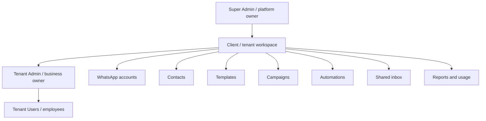

# Product Vision and Scope

## Vision

Build one compliant workspace where a business can acquire customers through approved WhatsApp campaigns, organize customer information, automate common conversations, and let human teams continue those conversations from a shared inbox.

The product is a **WhatsApp Marketing + Contacts + Shared Inbox + Automation SaaS**, not a bulk-sending utility.

## Primary outcomes

- Connect eligible WhatsApp Business accounts and phone numbers through an approved onboarding flow.
- Maintain contacts, consent, groups, custom fields, and conversation history.
- Create or synchronize approved templates and use them under WhatsApp messaging rules.
- Send immediate or scheduled campaigns through durable background workers.
- Receive inbound messages and delivery events through verified webhooks.
- Give agents a shared inbox with assignment, notes, and human handoff.
- Build versioned interactive automations from nodes and edges.
- Enforce tenant, role, package, policy, quota, and abuse controls server-side.
- Provide operational visibility through reports, usage records, audit logs, metrics, and alerts.

## Product hierarchy

## Personas

### Super Admin

The application creator and trusted platform partners operate the SaaS globally. They create and activate business accounts and their initial Tenant Admin, manage packages, subscriptions, billing, global settings, aggregate usage, operational health, and redacted audit activity. They do not access tenant contact PII or communication content through the application.

### Admin

The client/business owner—for example a doctor or car dealer—controls exactly one tenant workspace. The Admin configures WhatsApp connections, team users, contacts, templates, campaigns, automation, inbox, reports, and settings within plan entitlements. Admin-created work may be published directly, and the Admin reviews campaign/template work submitted by Users.

### Agent or employee

An employee, assistant, or crew member bound to the Admin's tenant. A User performs granted tenant operations without separate approval, including contact/group and inbox work. User-created or materially User-edited campaigns and templates require Tenant Admin approval before external publication/use.

## In scope

- Authentication, sessions, optional 2FA, RBAC, and granular permissions.
- Multi-tenant administration and client workspaces.
- WhatsApp onboarding, phone/account health, template sync, and supported business profile metadata.
- Contacts, groups, imports, consent, suppression, and custom fields.
- Campaign creation, preflight, scheduling, dispatch, recipient results, and exports.
- Inbound/outbound messages, delivery state, shared inbox, and realtime updates.
- Interactive choices, auto-replies, graph automation, versioning, testing, and handoff.
- Media library, package limits, usage ledger, reports, audit logs, and notifications.
- Security, privacy, backup, disaster recovery, observability, testing, and deployment.

## Out of scope or deferred

- Unofficial browser/session automation for WhatsApp.
- Bypassing templates, messaging windows, throttles, anti-spam controls, or account quality rules.
- Claims of unlimited unsolicited bulk messaging.
- Many independent microservices at initial launch.
- AI functionality before the core messaging, inbox, and automation systems are stable.
- White-labeling and advanced sales analytics in the MVP.

## Success indicators

- A supported client can onboard and reach a healthy connected state.
- A compliant campaign runs to completion after the initiating browser closes.
- Inbound messages appear once in the correct tenant inbox.
- An authorized agent can reply and the provider reports message progress.
- Interactive customer choices advance the correct published automation version.
- Human handoff stops unwanted automated replies.
- Cross-tenant access attempts fail and are covered by automated tests.
- Package and policy limits are enforced in backend execution paths.
