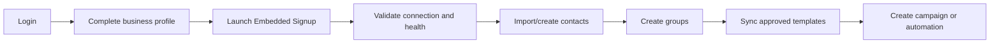

# User Experience and Screen Map

## Navigation principles

- Display only permitted modules, but rely on server-side authorization for enforcement.
- Keep connection, policy, quota, and delivery states understandable and actionable.
- Long-running work must expose progress and survive navigation or browser closure.
- Destructive, billable, or high-volume actions require a review/confirmation step.
- Errors must identify affected records and whether the user can retry, fix configuration, or contact support.

## Authentication

- Login
- Forgot/reset password
- Two-factor challenge and setup
- Active sessions/devices
- Security events

## Super Admin screens

- Global dashboard
- Admin management
- Tenants/users
- Plans and feature entitlements
- Subscriptions and usage
- WhatsApp account and connection-health metadata
- Aggregate contact, campaign, message/send, and queue monitoring
- Audit and system logs
- Global/provider settings

## Admin screens

- Own-business dashboard
- Team users and permissions
- WhatsApp accounts and connection health
- Contacts and Groups
- Templates and User template-approval queue
- Campaigns/posts and User campaign-approval queue
- Automation, shared inbox, media, reports, usage, and own-tenant audit activity

## User screens

- Own-business dashboard and all modules granted by the Tenant Admin
- Campaign/template draft editing and approval-request status
- Contacts, Groups, inbox, tracking, and other granted routine operations without approval prompts

Super Admin screens must use metadata/aggregate projections. They must not link to or render tenant contact records, recipient-level results, message/conversation content, customer media, raw provider payload content, detailed customer-data exports, or content search. The MVP has no break-glass customer-content screen. Tenant Admin and User navigation contains no business switcher.

## Client screens

- Dashboard
- WhatsApp accounts
- Contacts
- Groups
- Templates
- Campaigns
- Automation
- Inbox
- Media library
- Reports
- Team and roles
- Subscription and usage
- Settings

## Key workflows

### First-time setup

The UI must preserve onboarding progress and provide precise recovery steps when permissions, WABA subscription, phone registration, or template synchronization fail.

### Campaign builder

Use a guided sequence: details, sending account, audience, template, variable mapping, preflight, approval where required, schedule/send, and results. Preflight must show valid, invalid, duplicate, suppressed, missing-variable, and quota-blocked counts before confirmation. A User sees **Submit for approval** rather than schedule/send until the current material version is approved. The Admin approval view shows the exact version, audience summary, content/template, variables, account, schedule, policy/preflight result, and prior rejection. A material User edit visibly returns the item to approval-required state.

### Inbox

Use a two- or three-pane experience: filters/conversation list, active conversation, and optional contact/context panel. Clearly display assignment, automation state, service-window state, suppression, connection state, and send restrictions near the composer.

### Automation

Provide flow list, visual builder, node configuration, validation, test mode, version history, publishing, and analytics. Invalid or unreachable nodes, missing edges, cycles without safeguards, absent handoff paths, and unsupported message configurations should be visible before publication.

## State communication

Prefer explicit states over generic success/failure. Examples include:

- Connection: `PENDING`, `CONNECTED`, `DEGRADED`, `AUTH_FAILED`, `DISCONNECTED`.
- Meta/provider template: `DRAFT`, `PENDING`, `APPROVED`, `REJECTED`, `PAUSED`, `DISABLED` as supported.
- Internal campaign/template approval: `NOT_REQUIRED`, `DRAFT`, `PENDING`, `APPROVED`, `REJECTED`.
- Campaign: `DRAFT`, `SCHEDULED`, `QUEUED`, `RUNNING`, `PAUSED`, `COMPLETED`, `CANCELLED`, `FAILED`.
- Message: `CREATED`, `QUEUED`, `SENDING`, `SENT`, `DELIVERED`, `READ`, `FAILED`, `CANCELLED`.
- Automation run: `RUNNING`, `WAITING`, `PAUSED`, `HANDED_OFF`, `COMPLETED`, `FAILED`, `CANCELLED`.

Provider-accepted is not the same as delivered. The UI must distinguish synchronous acceptance from later webhook-driven delivery/read status.
