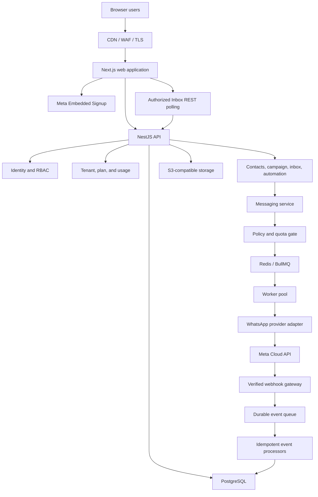

# System Architecture

## Architecture style

Begin with a modular monolith for the business API and separate deployable workers for messaging, webhooks, imports, media, and automation. Maintain clear domain interfaces so modules can be extracted later if scale or team ownership justifies it.

Do not begin with a large microservice estate. The early priorities are consistent authorization, transactional state changes, observable background work, and a safe provider boundary.

The frontend and backend are separate applications. Next.js owns the web experience, rendering, browser-facing navigation, and optional thin backend-for-frontend concerns. NestJS owns authentication, tenant authorization, business rules, persistence, public/internal REST contracts, provider integration, webhooks, and job production. Long-running and retryable work executes in separate NestJS/BullMQ workers rather than Next.js request handlers.

Keep these applications in one pnpm/Turborepo monorepo for the MVP. This preserves independent deployment and scaling while allowing shared TypeScript types, validation schemas, linting, and build tooling.

## Logical architecture

This diagram describes the full application, not the four-service hosted preview.
Inbox refresh uses REST polling (ADR-021); it does not require an event-push gateway.
See RAILWAY_LIMITED_PREVIEW.md for the smaller currently deployed topology.



## Modules and responsibilities

| Module | Responsibility |
|---|---|
| Identity | Login, refresh, logout, sessions, password reset, 2FA |
| Authorization | Roles, permissions, scopes, tenant context |
| Tenant | Tenant lifecycle, business profile, assignment, suspension |
| Plan/subscription | Entitlements, feature flags, quotas, renewal state |
| WhatsApp admin | Onboarding, WABA/phone mapping, sync, health, disconnect |
| Contacts | Contact identity, groups, custom fields, consent |
| Imports | File safety, parsing, normalization, validation, row reports |
| Templates | Provider sync, definitions, preview, status and variable checks |
| Campaigns | Audience, preflight, scheduling, recipient jobs, reports |
| Messaging | Composition, policy/quota checks, idempotency, dispatch |
| Webhooks | Verification, persistence, dedupe, routing, replay |
| Conversations | Inbox, message history, unread, assignment, notes |
| Automation | Graphs, versions, triggers, runs, node execution, handoff |
| Media | Uploads, scanning, metadata, signed access, provider media IDs |
| Reporting | Aggregations, exports, dashboard projections |
| Audit | Append-only security and business change records |
| Notifications | In-app and operational notices |

## Repository and application boundaries

```text
apps/
  web/       Next.js App Router frontend
  api/       NestJS REST API and webhook gateway
  worker/    NestJS/BullMQ background consumers and schedulers
packages/
  contracts/ Shared API DTO schemas and generated types
  config/    Shared lint, TypeScript, and build configuration
  ui/        Optional shared frontend UI primitives
```

Shared packages must not contain database repositories, provider credentials, or server-only business logic that could accidentally enter the browser bundle.

Python is not required for the main SaaS backend. If future AI, ML, document processing, or data workloads materially benefit from Python, add a narrowly scoped service behind an authenticated internal API or queue. The NestJS backend remains the system of record and policy boundary.

## MVP hosting decision

Deploy the initial production system in one Railway Pro project. Create separate Railway services for the Next.js web application, NestJS API, NestJS/BullMQ worker, and singleton scheduler. Use Railway PostgreSQL, Redis, private networking, and an S3-compatible Railway Bucket.

The platform target is 1,000-1,200 registered/daily users, with an initial planning assumption of 100-300 concurrently active users and approximately 20-50 API requests per second at peak. These are sizing assumptions, not guarantees; the release process must validate them through load testing. WhatsApp campaign recipient volume and provider throttling are expected to create more backend pressure than interactive user traffic.

See [Railway deployment and capacity](16-railway-deployment-and-capacity.md) for topology, scaling thresholds, operational requirements, and cost assumptions.

## Data ownership and consistency

- PostgreSQL is the system of record for business state.
- Redis is used for queues, short-lived locks, throttling, and cache; it is not the source of truth.
- Object storage holds uploads and large payloads using tenant-scoped randomized keys.
- Webhook events are persisted before asynchronous processing so they can be retried or replayed.
- Reporting counters are projections and must be rebuildable from authoritative records or usage events.
- State transitions that span database and queue should use a transactional outbox or an equivalent reliable handoff pattern.

## Realtime model

The first Inbox uses authorized, visible/online REST polling, with focus/reconnect/manual
refresh and stale-response protection (ADR-021; INBOX_REFRESH.md and INBOX_UI.md).
SSE/WebSocket publication is deferred, not a current dependency. If separately approved
later, push subscriptions must preserve tenant/user authorization and reconnect resynchronization.

## Scale boundaries

- Scale web/API containers independently from workers.
- Apply per-tenant and per-phone-number concurrency controls.
- Partition very large message or event tables only after measured need.
- Index tenant ID with frequent filters and sort columns.
- Batch imports and high-volume inserts/updates.
- Paginate contacts, messages, conversations, audit logs, and exports.

## Future extraction candidates

Webhook ingestion, messaging dispatch, imports, reporting, and automation execution are natural independent services if traffic or ownership requires it. Extraction must preserve the same provider adapter, event schemas, idempotency guarantees, and authorization context.
