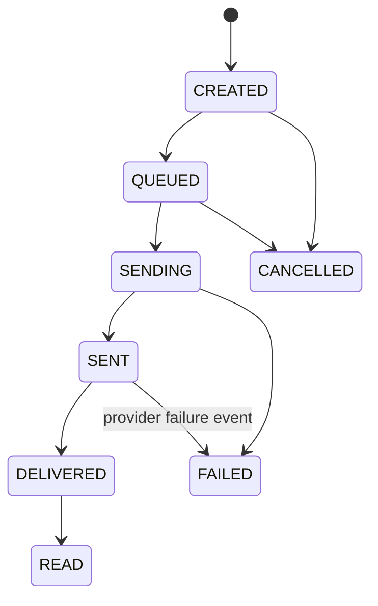

# Domain and Data Model

## Modeling rules

- The executable logical schema contract is maintained in
  `../apps/api/database/schema/`, with one SQL file per table and a verified manifest.
  New structure changes use versioned migrations with matching Drizzle/per-table contract updates (CLAR-077).
- The current MVP contract contains exactly 35 tables. `pnpm schema:verify` prevents silent
  table-count, file, and deletion-strategy drift.
- Tenant-owned relationships use tenant-matched composite foreign keys where both sides
  are tenant-owned.
- Each active Tenant Admin or Tenant User has one active `user_tenant_scopes` membership
  in the MVP. Super Admin is platform-scoped and has no tenant-content membership.
- Campaign/template internal approval is stored against an exact `content_version` and is
  independent from provider template approval. Material User edits invalidate approval.
- User-managed API-deletable entities follow the documented `is_deleted`, `deleted_at`,
  and `deleted_by` soft-delete contract. Active-only natural keys use partial unique
  indexes.
- Append-only and operational/history tables use lifecycle status, revocation, expiry,
  or retention cleanup rather than soft deletion.
- Every tenant-owned aggregate has a mandatory `tenant_id`, directly or through an enforced parent relationship.
- Use UUID or ULID identifiers for externally visible records.
- Use timezone-aware timestamps and store canonical values in UTC.
- Keep provider IDs separate from internal IDs and index provider message IDs.
- Treat audit and usage ledgers as append-only.
- Keep mutable counters rebuildable from source events.
- Store large or sensitive provider payloads by protected reference when full inline storage is unnecessary.
- Use JSON fields for variable provider/configuration data, not as a substitute for queryable core columns.

## Core entities

| Entity | Essential fields |
|---|---|
| `tenants` | `id`, `name`, `status`, `plan_id`, business profile, timestamps |
| `users` | `id`, `tenant_id`, `role_id`, `email`, `password_hash`, `status` |
| `roles` | `id`, `tenant_id?`, `name`, `system_flag` |
| `permissions` | `id`, `key`, description |
| `role_permissions` | `role_id`, `permission_id` |
| `plans` | `id`, `name`, price, validity, limits, feature flags, status |
| `subscriptions` | `id`, `tenant_id`, `plan_id`, status, period start/end |
| `whatsapp_accounts` | `id`, `tenant_id`, `waba_id`, `phone_number_id`, display phone, status, health |
| `provider_credentials` | `id`, `tenant_id`, provider, opaque reference, optional authenticated encrypted token, status, validated time |
| `contacts` | `id`, `tenant_id`, `phone_e164`, identity fields, custom fields, consent fields |
| `contact_groups` | `id`, `tenant_id`, `name` |
| `contact_group_members` | group and contact IDs, timestamps |
| `templates` | internal/provider IDs, tenant, content version, internal approval, provider status, components |
| `campaigns` | tenant, account, template, lifecycle state, content version, approval, schedule, audience, creator |
| `campaign_recipients` | campaign, contact, rendered variables, provider ID, state, error |
| `conversations` | tenant, contact, account, assignee, state, window expiry, last activity |
| `messages` | tenant, conversation, direction, type, provider ID, state, payload reference |
| `automation_flows` | tenant, name, state, published version ID |
| `automation_versions` | flow, version number, state, immutable published snapshot |
| `automation_nodes` | version, type, configuration, visual position |
| `automation_edges` | version, from/to nodes, condition |
| `automation_runs` | version, conversation, current node, state data, status, last event |
| `media_assets` | tenant, storage key, MIME, size, checksum, scan status |
| `usage_events` | tenant, event type, quantity, provider/message reference, occurred time |
| `audit_logs` | tenant, actor, role, action, entity, before/after, request/security context |
| `webhook_events` | provider, external event ID/hash, payload reference, processing state |

## Important constraints

- Contact phone uniqueness must be defined per tenant, with a documented merge/update policy.
- Provider WABA and phone-number mappings must prevent accidental assignment to multiple unrelated tenants.
- Provider message ID should be unique when present.
- Webhook external event ID, or a deterministic dedupe key where no ID exists, must be unique per provider/event type.
- Published automation versions are immutable.
- A campaign recipient must be unique for the campaign/contact/send attempt policy.
- Group membership joins must not associate records across tenants.
- An active Tenant Admin/User may have only one tenant membership in the MVP.
- Approved campaign/template rows must record a different requester/reviewer and
  `approved_version = content_version`; API services additionally enforce same-tenant
  Admin review and reset approval after material User edits.

## Message state machine

State updates must tolerate out-of-order and duplicate webhook events. A late event must not incorrectly regress a terminal or more advanced state unless provider semantics explicitly require correction.

## Consent and compliance fields

Contacts or a related consent ledger should support:

- `consent_status`
- `consent_source`
- `consent_at`
- `consent_category`
- proof/reference metadata
- `opt_out_at`
- `opt_out_source`
- `suppression_reason`

Conversations should support `last_customer_message_at` and `window_expires_at`. Sends should record the template, category, policy decision, and block reason used at dispatch time.

## Retention

Retention periods for contacts, messages, media, audit records, webhooks, exports, and backups are open decisions. Contact-import files and row-error reports are the approved exception: a configurable worker retention job purges them after 30 days by default and records upload deletion time. Implement all other retention as configurable jobs with legal holds or exceptions where required; never scatter fixed deletion periods across modules.

Soft deletion supports recovery from accidental application deletion but is not a backup
or privacy purge. Ordinary repository queries exclude soft-deleted rows. Restore paths
are explicitly authorized and must revalidate active uniqueness and parent state.
Permanent deletion is performed only by an approved retention/privacy workflow; backup
and point-in-time recovery remain independent requirements.
