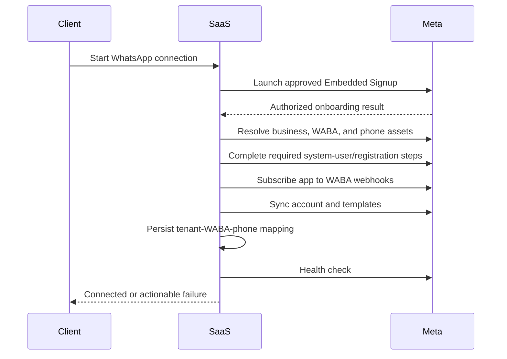

# WhatsApp Provider Integration

## Supported provider foundation

Use the official Meta WhatsApp Cloud API for messaging, the WhatsApp Business Management API for business assets, Embedded Signup for client onboarding, Webhooks for inbound and status events, Media endpoints for media, and WhatsApp Flows for supported structured interactions.

Use the Graph API version supported at implementation time. Keep the version in provider configuration and do not copy version strings throughout product code.

## Provider adapter

Only the adapter layer should understand exact Meta request/response payloads. Product modules operate on internal domain objects.

```ts
interface WhatsAppProvider {
  connectAccount(input: ConnectAccountInput): Promise<ConnectionResult>;
  syncAccount(accountId: string): Promise<AccountSyncResult>;
  sendText(input: SendTextInput): Promise<ProviderMessageResult>;
  sendTemplate(input: SendTemplateInput): Promise<ProviderMessageResult>;
  sendMedia(input: SendMediaInput): Promise<ProviderMessageResult>;
  sendInteractive(input: SendInteractiveInput): Promise<ProviderMessageResult>;
  uploadMedia(input: UploadMediaInput): Promise<MediaResult>;
  syncTemplates(accountId: string): Promise<Template[]>;
  subscribeWebhooks(accountId: string): Promise<void>;
  disconnectAccount(accountId: string): Promise<void>;
}
```

The adapter must normalize provider errors into internal validation, authentication, authorization, rate/transient, policy, configuration, and internal error classes.

## Provider route capabilities

| Capability | Route pattern | Product use |
|---|---|---|
| Send messages | `POST /{PHONE_NUMBER_ID}/messages` | Central outbound adapter after gates |
| Subscribe WABA | `POST /{WABA_ID}/subscribed_apps` | Enable webhook delivery |
| Phone assets | `GET /{WABA_ID}/phone_numbers` | Discover and synchronize numbers |
| Templates | `/{WABA_ID}/message_templates` | Sync and allowed management |
| Upload media | `POST /{PHONE_NUMBER_ID}/media` | Obtain provider media ID |
| Media metadata | `GET /{MEDIA_ID}` | Retrieve supported media information |
| Business profile | `/{PHONE_NUMBER_ID}/whatsapp_business_profile` | Supported business metadata |
| Flows | `/{WABA_ID}/flows` and related routes | Structured flow lifecycle |

Exact fields, permissions, endpoints, and versions must be confirmed against current official Meta documentation during implementation.

## Embedded Signup flow

CLAR-071: configurable foundation is implemented, not the complete sequence below.
WHATSAPP_ONBOARDING_MODE selects development/embedded_signup with API-driven UI and
manual-connection service denial outside development. See WHATSAPP_ONBOARDING.md for pending
credential-storage approval, callback completion and owner-managed production activation.



Before production, the organization must confirm whether it acts as a Meta Tech Provider/Solution Partner or uses another approved partner arrangement. App Review, Advanced Access, legal URLs, support URLs, test assets, and business verification must be planned early.

## Credential management

ADR-031 / CLAR-071: owner approved encrypted PostgreSQL token envelopes with separately
configured versioned server keyring. Internal service/repository storage and shared API/Worker
resolution implemented; no public token-entry endpoint or actual signup exchange yet. See
WHATSAPP_ONBOARDING.md for key handling, pending partner-model decision and combined tests.

- Meta credentials are not required until a Meta development app is created. At that
  point, add them only to the uncommitted local `.env` file or Railway service variables;
  never commit them to Git, documentation examples, tests, or fixtures.
- Never place a permanent provider credential in browser storage or responses.
- Store secrets in a secrets manager; persist references or encrypted values only.
- Encrypt at rest and in transit.
- Redact authorization headers, tokens, and sensitive payload fields from logs.
- Use separate development, staging, and production credentials.
- Track credential status and last validation time.
- Support revocation/disconnect and alert on authorization failures.
- Apply least privilege and controlled secret rotation.

### Runtime configuration contract

The server reads `META_GRAPH_API_VERSION`, `META_APP_ID`, `META_APP_SECRET`, and
`META_WEBHOOK_VERIFY_TOKEN` only from runtime configuration. The provider configuration
boundary rejects incomplete configuration with a safe normalized error and must never
include values in an API response or log. Development uses a local ignored `.env`; Railway
uses service variables. The app's API development command is `tsx watch` with the root
environment file loaded before startup.

### Development tenant connection (TASK-032)

For the development app only, an authenticated Tenant Admin with `whatsapp.connect` may
create a tenant mapping through `POST /whatsapp/connect`. The request contains Meta's
test WABA and phone-number identifiers, display metadata, and an opaque server-side
credential reference (for example, `env://META_TEST_SYSTEM_USER_TOKEN`). It must not
contain the credential value. The API stores the reference in `provider_credentials`,
never returns it, and writes a redacted `WHATSAPP_DEVELOPMENT_CONNECTED` audit record in
the same transaction as the account mapping. The connection is marked `CONNECTED` for
local integration work; account validation, subscription, synchronization, health, and
disconnect behavior remain separate TASK-033+ work.

This is not a substitute for client-facing Meta Embedded Signup. That production flow is
deferred until the approved Meta Tech Provider/Solution Partner arrangement and exact
credential exchange are confirmed.

### Development account health and disconnect (TASK-033)

The development adapter calls Meta's official `/{WABA_ID}/phone_numbers` Graph API route
and matches the persisted phone-number ID. It stores the current display phone, verified
name, quality rating, health status, and synchronization timestamp without retaining raw
provider responses. `RED` quality is reported as `DEGRADED`; a valid non-red test asset
is `CONNECTED`. Authentication/authorization failures produce `AUTH_FAILED` and mark the
credential reference `INVALID`; other provider failures leave an actionable `DEGRADED`
state. Provider calls are always outside database transactions.

The development disconnect endpoint is deliberately local-only: it marks the account
`DISCONNECTED`, marks its credential reference `REVOKED`, removes it as the default,
selects another connected default if one exists, and retains historical records. It does
not deregister the phone, unsubscribe the WABA, or revoke the Meta token upstream. Those
destructive production operations need the deferred partner/credential-ownership design.

### Template synchronization and approval (TASK-034)

`POST /templates/sync` reads the official `/{WABA_ID}/message_templates` collection
through the provider adapter. It normalizes the provider template ID, name, language,
category, lifecycle status, rejection reason, last-updated time, and JSON components;
it follows cursors with a bounded 10,000-template safety limit. Raw Meta responses and
credentials are not persisted or returned.

Meta's `provider_status` is independent from internal approval. Provider-discovered
templates use `NOT_REQUIRED` for internal approval because they are provider-originated.
Tenant User-created/materially edited templates start or return to `DRAFT`, increment
`content_version`, and clear request/review evidence. They can then be submitted for
review; only a different Tenant Admin may approve or reject that exact version. A
provider-sync component change also invalidates non-Admin approval to prevent a stale
approval from applying to changed provider content. Deterministic preview data exposes
only normalized header/body/footer text from the stored component array.

## WhatsApp Flows

Treat a WhatsApp Flow as a specialized automation node, not the whole automation engine. Store provider Flow ID, version, status, validation, and publication state. Publish only validated flows, minimize stored response data, and define fallback behavior for unsupported clients.

## Change management

TASK-052 shares the API/worker provider implementation in packages/whatsapp-provider.
Send, retry, ambiguity and private-replay behavior is documented in
[Outbound delivery operations](OUTBOUND_DELIVERY_OPERATIONS.md).

- Keep provider version in centralized configuration.
- Maintain adapter contract tests and recorded/sanitized fixtures.
- Review official changelogs before upgrades.
- Run staging compatibility tests before production change.
- Record endpoint/field migrations and rollback steps.
- Never make an emergency version upgrade by scattered code edits.
