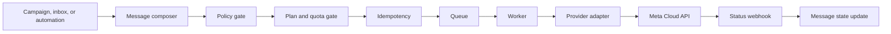

# Messaging, Campaigns, and Webhooks

## Outbound pipeline

Every send path must use this service. Campaigns, agents, and automation may not call the provider directly.

For User-authored or materially User-edited campaigns, both the scheduling/send API and the worker must confirm that an active Tenant Admin of the same tenant approved the exact current `content_version`. Admin-authored or materially Admin-edited campaigns do not require a second internal approver. A material User edit after approval invalidates approval before the edit commits.

## Policy gate

Before enqueueing, evaluate in this order:

1. Tenant and subscription are active.
2. Actor/system action is authorized.
3. The campaign's internal approval status and approved material version are valid when required.
4. WhatsApp account is connected and usable.
5. Contact is valid and not suppressed for the requested purpose.
6. Consent supports the message category/use case.
7. Customer-service window permits the message type, or a template with valid internal Admin approval when required and Meta approval is selected.
8. Template, variables, media, and interactive content are valid.
9. Package features, usage, and storage/message quotas permit the action.
10. Rate/concurrency rules permit queueing or assign a delayed/throttled state.

Store the decision and a stable policy-block reason. Never silently drop a blocked message.

### Implemented common composition boundary

`TASK-050` provides the backend-only `MessagingService.createOutboundMessage()` boundary;
it intentionally has no standalone HTTP controller. Tenant services call it after their
source-specific workflow checks. It accepts initial `TEXT` and `TEMPLATE` content only.
Free-form text requires an open customer-service window. A business-initiated template
requires an opted-in Contact, Meta `APPROVED` status, internal `NOT_REQUIRED` status or an
`APPROVED` decision for the exact current version, and an exact variable-key match.

The service rejects Super Admin and missing source permissions before persistence. It
then validates one tenant-matched Conversation, active Contact, WhatsApp account, provider
credential, subscription, and plan. `OPTED_OUT` and `SUPPRESSED` Contacts are blocked for
every outbound type. Only `TRIAL` and `ACTIVE` subscriptions may reserve message usage.

Valid policy denials against existing tenant resources are persisted as `FAILED` Messages
with a stable safe block code and redacted audit evidence; authorization, malformed input,
and cross-tenant/not-found attempts do not create a content record. Accepted messages are
stored as `CREATED`. A tenant/month advisory transaction lock serializes quota decisions,
and the Message, one append-only `OUTBOUND_MESSAGE_RESERVED` usage event, and audit record
commit atomically. A stable tenant/client-key transaction lock is taken before the
tenant/month quota lock, including across a UTC month boundary. Reuse of the same tenant
`client_message_key` and normalized content returns the existing Message without another
reservation; different content conflicts.
Replay reads the immutable composition decision rather than later mutable provider errors.
TASK-052 provides worker revalidation, provider calls, and retry/dead-letter behavior.
TASK-051 writes `message.outbound.created` in the same
transaction as each accepted Message and usage reservation. The event payload contains
only `message_id`.

The message outbox relay reclaims stale processing locks, publishes a deterministic
`outbound-message-{messageId}-{outboxEventId}` BullMQ job, and atomically marks the durable outbox event
`PUBLISHED` and the Message `QUEUED`. Message content, recipient data, and credentials
remain in PostgreSQL. The thin queue processor uses a Service/Repository boundary but is
enabled with TASK-052 durable claims, normalized acceptance, bounded retries and restricted
private replay. See docs/OUTBOUND_DELIVERY_OPERATIONS.md and ADR-019.

## Campaign preflight

TASK-053 now provides tenant-scoped campaign draft API/UI for Contacts and static Groups,
literal/Contact-field mappings and transactional material-version invalidation.
Draft saves never enqueue or send. See `CAMPAIGN_DRAFTS.md`; saved segments remain deferred.

Preflight must snapshot or deterministically resolve the intended audience and report:

- Connected sending account.
- Internally Admin-approved when required, Meta-approved, and otherwise eligible template.
- Current campaign material version and approval status.
- Valid/invalid phone numbers.
- Duplicates according to campaign policy.
- Suppressed/opted-out contacts.
- Missing variables or media.
- Plan and quota availability.
- Estimated recipients and usage.
- Automation/campaign state conflicts and duplicate-start risk.

Invalid recipients may be skipped only with visible reasons; campaign-level failures block execution when correctness would be compromised.

TASK-054 implements this as a durable asynchronous diagnostic workflow. The API transaction
creates a version-bound run plus identifier-only outbox event; BullMQ performs audience expansion
outside API request capacity, and the UI polls aggregate results. Active Contacts from explicit
selection and static Groups are deduplicated into `campaign_recipients` with `PENDING` or an
explicit `SKIPPED` reason. Preflight never reserves quota. Insufficient quota blocks the whole
campaign rather than truncating its intended audience. Material edits supersede active runs and
remove stale snapshots. See `CAMPAIGN_PREFLIGHT.md`.

## Scheduling and dispatch

TASK-055 implements the lifecycle described in `CAMPAIGN_LIFECYCLE.md`. Requests become
durable `QUEUED` work; final preflight uses the existing outbox/BullMQ path. Future schedules
become `SCHEDULED` only after successful final preflight and recheck when due. The worker uses
the existing composer in 25-recipient transactions, with message-key locks before the common
quota lock, then the existing message outbox/provider pipeline. Pause defers unclaimed jobs;
cancel preserves accepted/in-flight delivery history. Automated acceptance tests are deferred.

- Store requested schedule timezone and canonical UTC execution time.
- The scheduler transitions eligible campaigns into durable queue work.
- Scheduling and dispatch reject a campaign if its current material version differs from the Admin-approved version.
- Generate recipient jobs in batches and use per-tenant/per-phone concurrency controls.
- Persist an attempt before or atomically with dispatch to reduce duplicate-send risk.
- Retry only retryable failures with exponential backoff and jitter.
- Send exhausted jobs to a dead-letter or manual-recovery state.
- Pausing/cancelling stops work not yet accepted by the provider; the UI must not imply recall of accepted messages.

## Webhook gateway

### Verification request

Validate the configured verification token and return the required challenge only when valid.

### Event request

1. Read the raw request body.
2. Validate `X-Hub-Signature-256` using the configured app secret.
3. Validate the provider envelope sufficiently to route it.
4. Calculate a SHA-256 dedupe key from the exact signed raw delivery bytes.
5. Persist the verified JSON payload and, when exactly one Meta phone number is present,
   resolve its local account and tenant from server-owned data.
6. Return success quickly without waiting for business processing.

The webhook receiver never logs or exposes the stored payload. The unique
`(provider, external_event_key)` constraint makes a Meta retry of the exact delivery a
no-op. Each new event creates a transactional `webhook.event.received` outbox record;
the worker claims it with PostgreSQL row locking, publishes only an event UUID to BullMQ,
and atomically marks the event `QUEUED`. The raw verified payload stays in PostgreSQL.

Invalid signatures must be rejected and logged safely. Large payload and request-rate limits apply.

## Event processors

- Inbound processor creates or updates the correct conversation/contact/message.
- Status processor advances message and campaign-recipient state.
- Automation processor evaluates relevant triggers against the published version.
- Usage processor appends billable/entitlement events.
- Analytics processor updates rebuildable projections.
- Account/template processors handle supported configuration events.

Each processor is idempotent. Duplicate webhook delivery must not create duplicate messages, usage, automation transitions, or notifications.

### Implemented initial event processor and operations recovery

- The initial processor creates or finds the tenant Contact and WhatsApp-account
  Conversation, inserts an inbound Message once by provider message ID, and only then
  increments conversation unread/activity state.
- Delivery events update Message and Campaign Recipient state monotonically: late `SENT`
  cannot overwrite `DELIVERED` or `READ`; `FAILED` cannot regress a confirmed delivery.
- A Meta `deleted` status is retained only in the protected verified webhook record. It
  does not change message state until a reviewed `DELETED` state is added to the schema.
- A processing job retries five total attempts with 1, 2, 4, 8, and 16-second exponential
  delays. The final failure marks the event `DEAD` with a safe error code. No provider
  payload is included in logs or error state.
- Operations may replay only `FAILED` or `DEAD` records using the private worker command:
  `pnpm --filter @whatsapp-platform/worker webhook:replay <webhook-event-uuid>`. It resets
  the record to `RECEIVED` and makes a new durable outbox handoff; it is not an HTTP API.

## Ordering and reconciliation

Provider events can be late, duplicated, or out of order. Store provider timestamps and receipt time, use monotonic transition rules where appropriate, and run reconciliation jobs for stuck sends or gaps. A provider API acceptance only means `SENT`/accepted under the internal mapping; `DELIVERED` and `READ` require later evidence. A status event received before its Message exists remains durable and retries; reconciliation remains a later task.

## Campaign reporting

Aggregate from recipient/message state and expose counts for total, valid, skipped, queued, sending, sent, delivered, read, failed, cancelled, and responses where measurable. Reports must disclose update latency and provide recipient-level error export subject to authorization and privacy controls.
