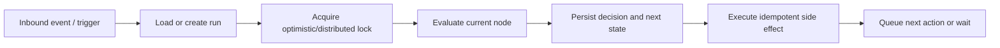

# Inbox and Automation

## Shared inbox

TASK-064 selects the 15-second visible/online REST polling foundation for the MVP (ADR-021).
TASK-066 now mounts it in the Shared Inbox UI; server-push delivery remains deferred.
See `INBOX_UI.md` for the delivered flow and `PHASE_6_TEST_REPORT.md` for verification limits.
See `INBOX_REFRESH.md` for focus/reconnect refresh, cancellation, backoff and auth boundaries.

Inbound webhook processing resolves the tenant and WhatsApp account, normalizes the sender,
creates or finds the contact and conversation, stores the message once, and updates
unread/last-activity state. TASK-036 provides that durable foundation; automation evaluation
and authorized realtime delivery remain future work.

TASK-060 reuses this foundation with service-owned transaction/policy orchestration and
repository-only SQL. Deleted-only sender identities are held through existing failure/review
states without automatic recovery; invalid inbound timestamps fail rather than opening a
processing-time reply window. Tenant/account checks apply to inbound and status effects,
and duplicate provider IDs do not repeat unread or STOP effects. See
`INBOX_INBOUND_RESOLUTION.md` for the approved behavior, replay limitations and deferred tests.

### Composer rules

| Conversation state | Composer behavior |
|---|---|
| Customer-service window open | Allow supported free-form reply; templates also available |
| Window closed | Require an approved eligible template |
| Contact suppressed | Block prohibited marketing sends and show reason |
| Automation active | Show bot state; authorized human reply can hand off/pause |
| Account disconnected | Disable sending but preserve history |
| User lacks permission | Read-only or no access according to scope |

Replies must pass through the same messaging, policy, quota, idempotency, and provider pipeline as every other outbound message.

TASK-062 implements the backend TEXT/approved TEMPLATE reply route through that pipeline.
New replies require OPEN/PENDING and non-ACTIVE automation, with checks inside the common
composer transaction. No automatic reopen or handoff occurs; see `INBOX_REPLIES.md` (CLAR-033).

## Conversation operations

TASK-063 adds backend assignment/unassignment and separate append-only note list/create
APIs. Internal work does not send customer messages, change unread or perform implicit
handoff/reopen. Reuse existing permissions and active same-tenant assignee validation;
see `INBOX_COLLABORATION.md` (CLAR-034). No inbox UI is included in that task.

TASK-061 implements the backend list/detail, name/phone search, account/status/unread filters,
cursor pagination, shared read/unread and close/reopen contracts in `INBOX_API.md`. GET never
marks read. Local read/unread uses conversation.read; close/reopen also requires
conversation.close. These commands do not send read receipts or affect outbound messaging,
service-window expiry, consent or automation. No inbox UI is delivered in TASK-061.

- Search and filter authorized conversations.
- Read message history with delivery state and attachments.
- Mark read/unread.
- Assign/reassign to a team member or queue.
- Add internal notes that are never sent to the customer.
- View and update permitted contact information.
- Close, reopen, or archive while retaining history according to policy.
- Audit assignments, sensitive access, handoff, and outbound actions.

## Automation graph

CLAR-038 / [BASIC_AUTOMATION.md](BASIC_AUTOMATION.md) is the approved Phase 7 MVP contract.
The form-based editor, exact keywords, correlated choices and explicit ownership controls
use the existing schema and messaging path. Only the eight nodes below are in this MVP.

Supported node types:

| Node | Purpose |
|---|---|
| START | Entry point |
| MESSAGE | Send text |
| BUTTONS | Present quick replies |
| LIST | Present list menu |
| ASSIGN | Assign a team member/queue |
| CONTACT_UPDATE | Update permitted contact fields |
| HUMAN_HANDOFF | Pause/stop bot and route to human |
| END | Complete run |

MEDIA, INPUT, CONDITION, DELAY and WhatsApp FLOW nodes are deferred, as are entry-link/QR,
campaign-reply trigger configuration and catch-all triggers. ASSIGN targets a team member,
not a new queue system. CONTACT_UPDATE is literal name/email/company/address only.

## Versioning and publication

- Draft graphs are editable.
- Publication validates graph structure and creates an immutable version.
- New conversations use the currently published version.
- Active runs remain pinned to the version they started with.
- Editing after publication creates another draft/version.
- Retiring a version prevents new runs but preserves historical execution.

MVP validation requires one start, reachable nodes, valid targets/configurations, exactly one
transition per immediate step or choice, at most 30 nodes and no cycles. Human takeover is
always available in the authorized Inbox; unrelated replies while waiting hand off silently.

## Run execution

- One conversation must not advance the same run concurrently.
- Persist sufficient state before duplicate-prone side effects.
- Each message side effect has a stable run/node key; retry attempts never change its identity.
- If a customer-facing DELAY node is introduced later, it must use durable scheduling, not
  in-memory timers. The MVP uses durable continuation/deadline jobs only, not a DELAY node.
- Retry policy varies by node and error class.
- Human handoff moves the run to HANDED_OFF and prevents further automated replies. Flow pause
  latches active runs PAUSED. Explicit allow permits fresh triggers only; it never resumes a run.

## Triggers and correlation

Keyword and interactive triggers must operate on normalized inbound events. Button/list response IDs should map to stable edge/action identifiers rather than display text. Campaign replies, entry links/QRs, and provider-supported events must carry enough context to select the intended flow without crossing tenants.

## Contact relationship

A contact is the customer identity and communication profile. A conversation is a communication thread linked to that contact and a WhatsApp account. Contact details, consent, suppression state, assignment, custom fields, source, and last interaction may be updated from authorized inbox or automation actions.

All automated follow-up messages must pass through the same consent, suppression, template, messaging-window, quota, and provider policy gates as campaign and agent messages.

## Analytics

Track flow starts, completions, drop-offs, errors, node/choice counts, time to handoff, handoff volume, and version. Avoid metrics that require storing unnecessary sensitive message content.
