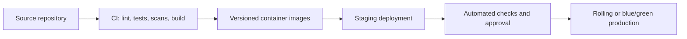

# DevOps, Reliability, and Observability

## Environments and delivery

Maintain separate development, staging, and production environments with separate credentials and data. Infrastructure should be defined as code, with Terraform recommended by the source architecture.

The MVP uses one pnpm/Turborepo monorepo but produces separate versioned build artifacts for `web`, `api`, and `worker`. A change may deploy only the affected application after shared contract and integration checks pass.

Railway Pro is the approved MVP production platform. Development may use Railway Hobby or local containers, but production services, data stores, private networking, buckets, domains, variables, health checks, and usage controls should be managed within one Railway project.

The repository's Docker Compose baseline supplies local PostgreSQL, Redis, MinIO, and Mailpit services with health checks and persistent volumes. Developer commands, endpoints, and data-reset behavior are documented in [Local development infrastructure](LOCAL_DEVELOPMENT.md). These local credentials and services must never be reused as production configuration.

Database migrations require a controlled, backward-compatible release process. Secrets enter workloads only through the approved secrets manager.

API and worker processes must parse the shared typed runtime configuration before application initialization. Validation errors identify only variable names and constraints, never submitted values. Production startup fails when authentication, encryption, or Meta credentials are absent. The checked-in environment template and validated key registry are kept in exact parity by an automated test.

## Production topology

- CDN and WAF.
- Next.js web containers.
- NestJS API containers.
- Independently scalable worker containers.
- Managed PostgreSQL.
- Redis for queues/cache/locks.
- S3-compatible object storage.
- Secrets manager.
- Central logs, metrics, traces, alerts, and dashboards.

On Railway, map this topology to separate `web`, `api`, `worker`, and `scheduler` services plus PostgreSQL, Redis, and a Bucket. Keep `scheduler` at exactly one replica. Scale `api` and `worker` independently. Use private service/database endpoints to avoid unnecessary public exposure and egress.

Do not run campaign dispatch, webhook business processing, contact imports, or automation timers inside the Next.js deployment. These belong to durable worker deployments that can scale and restart independently.

## Reliability controls

- Timeouts on all external calls.
- Retries only for classified transient failures, with exponential backoff and jitter.
- Idempotency for send, webhook, usage, and automation side effects.
- Dead-letter/manual recovery for exhausted jobs.
- Backpressure and per-tenant/per-phone concurrency.
- Health and readiness probes.
- Graceful worker shutdown without abandoning locked jobs.
- Reconciliation for stuck messages, missing statuses, and incomplete imports.
- Durable webhook event retention sufficient for replay and recovery.

## Metrics and alerts

| Signal | Reason | Typical alert |
|---|---|---|
| Webhook latency | Inbound reliability | Above SLO |
| Webhook verification/processing failures | Lost or spoofed events | Spike |
| Queue depth and oldest job | Throughput/backlog | Growing or stale |
| Worker failure/retry/DLQ rate | Processing health | Threshold/spike |
| Provider 4xx/5xx and auth errors | Policy/config/provider health | Spike or sustained |
| Message failure rate | Account/content quality | Tenant/global spike |
| Automation errors and handoff failures | Customer experience | Threshold |
| DB CPU, latency, locks, connections | Core availability | Threshold |
| Redis memory/evictions/latency | Queue/cache health | Threshold |
| Storage growth and scan failures | Capacity/security | Threshold |
| Quota breaches and send anomalies | Commercial/abuse control | Repeated/unusual |

## Logging and tracing

Use structured JSON logs with timestamp, severity, service/module, event type, request ID, tenant ID, user/service ID where appropriate, job/event ID, and latency. Redact tokens, authorization headers, phone numbers, sensitive content, and secrets. Distributed traces should follow API to database/outbox/queue/worker/provider and webhook to processor.

The backend baseline uses Pino through one shared server-only observability package for
the API and workers. HTTP request serializers log only the request ID, method, and path;
they intentionally omit query strings, headers, and bodies. Sensitive field paths are
redacted as a second line of defense. Unhandled server failures include safe structured
diagnostics in logs while returning only the standard public error envelope.

Railway health checks should use versionless `GET /health/live` for process liveness and
`GET /health/ready` for traffic readiness. The initial readiness check covers validated
application configuration. PostgreSQL, Redis, and object-storage readiness must be added
when their clients are implemented; until then, the endpoint must not claim to test those
dependencies.

## Backup and disaster recovery

- Automated PostgreSQL backups with point-in-time recovery where supported.
- Versioning/backup policy for important object-storage buckets.
- Encrypted backups and restricted restoration access.
- Defined Recovery Point Objective and Recovery Time Objective.
- Quarterly restore testing at minimum.
- Documented incident and disaster-recovery runbooks.
- Provider event retention and replay tools for recovery.

RPO, RTO, retention, region strategy, hosting provider, and high-availability tier remain open decisions.

## Capacity and performance

Load-test campaigns, webhook bursts, large imports, inbox pagination, automation fan-out, and report exports. Autoscaling must respect provider and per-phone limits. Database indexes should reflect measured tenant-scoped queries. Redis must not become the only record of business state.

The capacity target is 1,000-1,200 registered/daily users, 100-300 concurrent active users,
and 20-50 peak interactive API requests per second; it is not a verified guarantee.
CLAR-030 / MVP_DELIVERY_PRIORITIES.md governs acceptance: agree and verify the initial
deployed workload and critical recovery/safety paths before limited launch. The full
1,200-login/minute, 300-active-session, 100,000-recipient and 1,000-Inbox-client workloads
are extended capacity targets to verify before expanding to that load, not a reason to
add speculative infrastructure or claim full capacity from small local tests.

Resource and scaling guidance is maintained in [Railway deployment and capacity](16-railway-deployment-and-capacity.md).

## Release safety

Use feature flags for risky modules, staged rollout, smoke tests, rollback/run-forward plans, dependency/container scanning, and monitored post-deploy windows. Provider API version upgrades require their own compatibility release process.

## Local quality and security baseline

GitHub is currently used only for source control and repository storage. Automated
GitHub Actions workflows remain deferred until the owner explicitly enables CI. Before
each commit or push, contributors run `pnpm check` locally for formatting, lint, strict
type checking, unit/integration tests, and production builds.

`pnpm security:audit` blocks high and critical findings in production dependencies.
`pnpm security:audit:all` additionally reports development-tooling findings so they are
not hidden. CI must reproduce these local commands when TASK-015 resumes. CodeQL,
container scanning, and automated secret scanning are not active while GitHub automation
is deferred.
