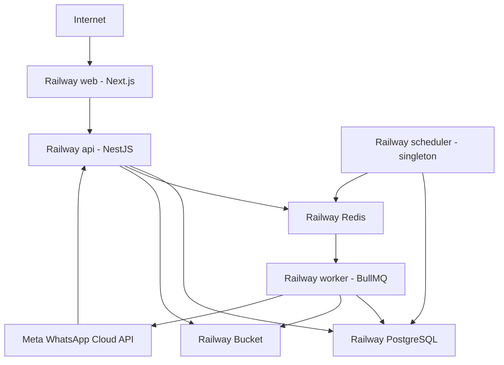

# Railway Deployment and Capacity

## Current deployment versus full-rollout plan

The owner-approved hosted preview uses trial credit and Web/API/PostgreSQL/Redis, with
Web-only public HTTPS and a private API. See [current preview configuration](RAILWAY_LIMITED_PREVIEW.md)
for the dated deployment/migration evidence; it does not certify full staging or customer launch.
The Railway Pro/worker/scheduler/storage layout below remains the full-rollout plan, not
the current hosted topology. Do not add services or upgrade based on this plan alone.

TASK-082 / CLAR-042 repository preparation is documented in
[Railway staging preparation](RAILWAY_STAGING_GUIDE.md) and infra/railway manifests.
The full deployment consumer entry point separates the campaign timer into a singleton
scheduler; outbox relays, automation recovery and import retention remain with consumers.
Combined local worker behavior is retained. Bucket authorization uses its issued HTTPS S3
endpoint, not an invented private-network endpoint. TASK-081 exports are bounded direct
downloads without stored objects/export queues; large asynchronous exports remain deferred.
Full runtime/security/operations/UAT gates remain open in TASKS.md.

Status: Approved MVP deployment baseline  
Decision date: 2026-10-07  
Target: First 1,000-1,200 registered/daily users

## Decision

Use Railway Pro as the single MVP application ecosystem. Deploy the Next.js frontend, NestJS API, BullMQ workers, singleton scheduler, PostgreSQL, Redis, and S3-compatible object storage in one Railway project.

Railway Hobby may be used for development or early internal testing. Move to Pro before onboarding production customers.

This decision minimizes operational overhead and preserves the application boundaries defined elsewhere. It does not convert the architecture to serverless functions and does not remove the separation between web, API, workers, and data services.

## Capacity assumptions

The first-level target is:

- 1,000-1,200 registered/daily users.
- Approximately 100-300 concurrently active users.
- Approximately 20-50 interactive API requests per second at peak.
- Up to 1,200 login attempts distributed over one minute during a stress scenario.
- Large campaigns processed asynchronously, initially tested at 100,000 recipients.
- Webhook bursts absorbed by durable queues.

These figures are planning assumptions and must be validated by load tests. They are not service-level guarantees. The number of campaign recipients, webhook events, media transfers, and Meta-imposed throughput limits will usually matter more than the number of logged-in users.

Users should not perform a full password login every minute. Use short-lived access tokens and rotating refresh sessions so normal activity does not repeat password hashing.

## Railway topology

Only the web application, required API routes, and Meta webhook endpoint should be public. PostgreSQL, Redis, worker, and scheduler communication should use Railway private networking.

## Services

### `web`

- Runs the Next.js App Router application.
- Does not execute campaign processing, webhook business processing, imports, or automation delays.
- Calls the NestJS API through its configured public or internal endpoint as appropriate.
- Starts with one replica and approximately 512 MB memory.

### `api`

- Runs the NestJS REST API and fast webhook receiver.
- Remains stateless; sessions and business state are external.
- Writes durable database/outbox state before queue publication.
- Starts with one replica and approximately 1 GB memory.
- Move to two replicas for availability or when measured latency/CPU warrants it.

### `worker`

- Runs BullMQ consumers for message dispatch, webhook processing, imports, automation, and exports.
- Re-loads authoritative database state before external side effects.
- Uses retries, backoff, idempotency, and dead-letter/manual recovery states.
- Starts with one replica and approximately 1 GB memory.
- Scale by queue depth, oldest job, provider rate limits, and job latency rather than user count.

The first MVP may combine consumers in one worker process with separate queues and concurrency settings. Split messaging, event, and import workers when one workload delays another.

### `scheduler`

- Activates due campaigns, delayed automation, outbox relay, and maintenance work.
- Runs exactly one replica initially.
- Uses database/Redis locks and idempotency because restarts or duplicate triggers remain possible.
- May share code with the worker but has a distinct Railway service and start command.

### PostgreSQL

- Source of truth for tenant, identity, contacts, campaigns, conversations, messages, usage, audit, and event state.
- Start near 1-2 GB memory and increase based on connections, cache hit rate, latency, and table growth.
- Use connection pooling, tenant-aware indexes, controlled migrations, automated backups, and tested restoration.
- Do not expose publicly unless an approved temporary administrative workflow requires it.

### Redis

- BullMQ queues, short-lived cache, distributed locks, rate control, and scheduling support.
- Start near 256-512 MB and monitor memory/evictions.
- Use persistence appropriate for queue durability.
- Redis is not the system of record.

### Bucket

- Stores imports, media, generated exports, and large protected payloads.
- Use tenant-scoped random object keys and short-lived signed URLs.
- Validate and scan uploads before making them available.
- Do not store uploads on application container filesystems.

## Initial and scaled profiles

### Budget production profile

| Component | Replicas | Planning memory |
|---|---:|---:|
| Web | 1 | 512 MB |
| API | 1 | 1 GB |
| Worker | 1 | 1 GB |
| Scheduler | 1 | 256-512 MB |
| PostgreSQL | 1 | 1-2 GB |
| Redis | 1 | 256-512 MB |

### Availability/traffic profile

| Component | Replicas | Change trigger |
|---|---:|---|
| Web | 1-2 | Sustained CPU/latency or availability need |
| API | 2 | Production availability or p95 latency pressure |
| Worker | 2+ | Queue depth/oldest-job SLO breach |
| Scheduler | 1 | Remains singleton |
| PostgreSQL | 1 larger instance | Connections, cache, CPU, I/O, storage |
| Redis | 1 larger instance | Memory, latency, persistence/queue size |

## Cost baseline

Railway pricing is usage-based and can change. As of the decision date, the project should budget approximately:

- USD 50-100 per month for the initial production profile.
- USD 90-160 per month after adding API/worker replicas and larger data services.

These figures exclude Meta WhatsApp charges, domain registration, transactional email, payment gateway costs, third-party monitoring, taxes, and unusually high storage or network egress. Review actual Railway usage after at least one representative week rather than treating the estimate as a quote.

Configure Railway usage alerts and a spending limit. A hard limit can take workloads offline, so select a threshold that prevents runaway cost without causing an avoidable production outage.

## Environment organization

- `development`: local-first or Railway Hobby resources using non-production Meta credentials.
- `staging`: production-like services and migrations with isolated data and credentials.
- `production`: Railway Pro, production domains, production Meta credentials, backups, alerts, and restricted access.

Do not share PostgreSQL, Redis, buckets, provider credentials, or encryption secrets across staging and production.

## Deployment process

1. Build only affected monorepo applications.
2. Run lint, type checking, unit, integration, contract, tenant-isolation, and migration checks.
3. Build immutable images/artifacts for web, API, worker, and scheduler.
4. Deploy backward-compatible database migrations.
5. Deploy workers/API/web in an order compatible with the migration.
6. Run smoke tests for login, tenant access, database, Redis, bucket, provider health, and webhook verification.
7. Monitor errors, latency, queue depth, and resource usage through the post-deploy window.
8. Roll back code or run forward with a corrective migration; never destructively roll back production data without a tested procedure.

Each Railway service has its own start command and health/restart configuration. Preview environments must not automatically clone costly production services without cost controls.

## Required environment variables

Use Railway references/private endpoints where supported. Exact names are implementation-specific, but categories include:

- Application environment and public URLs.
- PostgreSQL connection and pool configuration.
- Redis connection and queue prefixes.
- Access-token signing and refresh-session secrets.
- Field/envelope encryption keys or key references.
- Meta app ID, app secret, webhook verification secret, and provider configuration.
- Bucket endpoint, region, bucket name, and scoped credentials.
- Logging, tracing, error monitoring, and notification configuration.

Secrets must never be committed, exposed to browser bundles, placed in queue payloads, or written to logs.

## Load and failure testing

Before production launch, verify:

1. 1,200 login attempts complete over one minute within the authentication SLO.
2. 300 active users can navigate contacts, campaigns, and inbox without unacceptable p95 latency.
3. The API sustains 20-50 representative requests per second.
4. A representative campaign at the owner-approved initial workload expands/processes without blocking interactive API requests; 100,000 recipients remains an extended scale target.
5. Webhook bursts and duplicates do not lose or duplicate business effects.
6. Verify authorized Inbox polling at the approved initial workload; 1,000 concurrent clients remains an extended target, not an already verified capacity claim.
7. Large contact imports do not exhaust API memory or database connections.
8. Worker termination and restart does not lose or duplicate sends.
9. Redis interruption, database restart, and provider timeout produce controlled recovery.
10. Cross-tenant access remains impossible under concurrency.

## Scaling signals

Scale the API when CPU, event-loop delay, p95 latency, or connection saturation remains high. Scale workers when queue depth and oldest-job age exceed the defined SLO. Scale PostgreSQL when CPU, I/O, memory/cache hit rate, connections, lock contention, or query latency indicate pressure. Scale Redis before memory eviction, persistence, or latency threatens queues.

Do not scale based only on registered-user count.

## Backup and recovery

- Automate PostgreSQL backups and define retention.
- Export or replicate critical backups outside the failure boundary if business risk requires it.
- Protect bucket data according to retention and recovery requirements.
- Persist webhook events long enough for replay.
- Test database restore and event replay before launch and at least quarterly.
- Document RPO, RTO, incident ownership, credential rotation, and provider reconciliation.

## Official references

- Railway pricing: https://docs.railway.com/pricing
- Railway plans: https://docs.railway.com/pricing/plans
- Railway data and storage: https://docs.railway.com/data-storage
- Railway cost controls: https://docs.railway.com/pricing/cost-control
- Railway right-sizing: https://docs.railway.com/guides/right-size-cpu-memory
