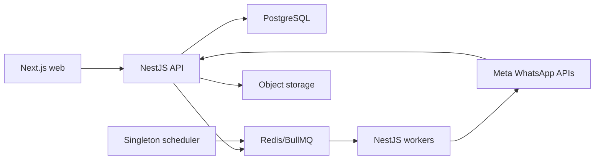

# Architecture Summary

CLAR-081 / ADR-034 adds partner Super Admin creation through dedicated Controller-Service-
Repository layers registered in full/preview AuthModule. Reuse existing catalog role,
password validator/hash/limiter/transactions and initial handover; no new schema/dependency,
bootstrap reuse or tenant-content path. See SUPER_ADMIN_CREATION.md for source-only status.

CLAR-070 / ADR-029 supersedes older preview exclusions for tenant reports/direct CSV,
development WhatsApp setup/sync, templates and campaign drafts/review. Existing services
are reused; campaign background commands fail closed. Storage/email, Inbox, automation and
webhooks remain absent. No new process/schema/dependency; full mode unchanged.

## Approved stack

CLAR-068 / ADR-027 extends preview with existing DB-only platform/Team administration and
bounded platform metadata reports. No bucket/provider/worker dependencies are added. It
supersedes the original blanket administration exclusion, not tenant privacy or full stack.

CLAR-065 / ADR-024 permits an explicit four-service test preview (Postgres/Redis/API/Web):
The original ADR-024 preview allowed login/session/manual Contacts/Groups only; ADR-027/029
and CLAR-071 subsequently expanded authoring/administration/onboarding. Current scope is in
RAILWAY_LIMITED_PREVIEW.md. Full/local default and full-rollout architecture below are unchanged;
authenticated UAT, provider acceptance and launch gates remain open.

CLAR-030 retains this architecture. Prioritize completing core workflows and reuse existing
modules; do not introduce microservices, extra infrastructure or speculative scale refactors.
Deployment tuning follows measured load. See `MVP_DELIVERY_PRIORITIES.md` for delivery and
launch-check boundaries; no binding architecture decision is replaced by this correction.

- Monorepo: pnpm workspaces and Turborepo.
- Frontend: Next.js App Router and TypeScript.
- API: dedicated NestJS REST API and TypeScript.
- Workers: NestJS standalone processes and BullMQ.
- Database: PostgreSQL.
- Data access and migrations: Drizzle ORM and drizzle-kit, with committed SQL migrations.
- Queue/cache/locks: Redis.
- Storage: S3-compatible Railway Bucket.
- Full-rollout hosting plan: Railway Pro; current limited preview uses Railway trial credit only.
- Provider: Meta WhatsApp Cloud API, Business Management API, Embedded Signup, and verified webhooks.

## Application boundaries

TASK-032.2 completes local direct Tech Provider connection: Controller -> EmbeddedSignupService
-> Redis/SQL repositories, with separate fixed-host Meta adapter and existing encrypted-token
service. One-use bound attempts precede external code/asset verification; tenant/account/token/
audit commit atomically. SDK/browser hints never authorize assets. APP_MODE preview does not
enable registration, webhooks, sending or workers. See WHATSAPP_ONBOARDING.md and local report.

ADR-031 / TASK-032.2.1: shared provider package owns authenticated credential cipher/resolution
policy. API server-only repository owns SQL and is reused by Worker through existing API package
dependency, with existing pools only. Internal service owns tenant policy/transaction/audit.
Migration0010 adds ciphertext/check, no table. ADR-032 now wires the signup code exchange
and asset verification into encrypted persistence; live provider acceptance remains pending.
No standalone public token-upload endpoint is introduced.

ADR-030 / CLAR-071: WhatsAppOnboardingService owns server-mode policy; existing controller
exposes a safe tenant projection and WhatsAppService checks mode before development writes.
UI consumes API state, not a browser build flag. ADR-031/032 extend this foundation with
encrypted credentials and implemented direct signup completion. Legacy environment references
remain supported; configuration readiness does not establish Meta approval or messaging activation.

TASK-082.4.5.3 corrects provisioning to the existing tenant-role model: PlatformService
uses TenantRoleProvisioningService plus seed catalog/repository to create each new
tenant's Admin/User roles and grants in the same transaction as Admin/membership/audit.
Team resolves only its current tenant's active system User role. No global-role fallback,
authorization relaxation, schema change or automatic repair of existing accounts.

ADR-028 / CLAR-069 enforces persisted first-login password change in live authorization,
with restricted /me and change handler only. Shared user-scoped transaction lock serializes
login/refresh/change; all sessions revoke at handover, followed by fresh login. See
INITIAL_PASSWORD_CHANGE.md for migration ordering and intentionally unchanged old accounts.

ADR-026 / CLAR-067 adds explicit protected first-Super-Admin initialization after migrations.
Controller maps HTTP; service orchestrates existing hashing/catalog/transaction; repositories
alone lock/query/write. No new schema or startup seed. See FIRST_SUPER_ADMIN_BOOTSTRAP.md.

ADR-025 / CLAR-066: preview may use browser -> Web HTTPS /api/v1 -> fixed private NestJS
API rewrite. No business/auth logic moves into Next.js; secure cookie policy is unchanged.
See RAILWAY_LIMITED_PREVIEW.md for build configuration and pending hosted verification.



- Web owns presentation and browser interaction.
- API owns identity, authorization, tenant scope, business rules, persistence, provider integration, and webhook receipt.
- Workers own durable/retryable messaging, webhook processing, imports, automation, and exports.
- Scheduler activates due work and remains a singleton unless leader election is added.
- PostgreSQL is the source of truth. Redis is not authoritative business storage.
- Authentication uses a 15-minute signed access token and a PostgreSQL-backed opaque
  refresh-session family with an absolute 30-day lifetime. Redis is used only for login
  rate control; refresh state and revocation remain durable in PostgreSQL.

## Core rules

- Keep a modular monolith with clean domain boundaries.
- Enforce Controller -> Service -> Repository dependency flow for every backend feature. Controllers and queue processors are thin transport adapters; services own use-case orchestration, transactions, business/policy rules, and external-adapter coordination; repositories alone access Drizzle/PostgreSQL.
- Use constructor dependency injection between layers. Do not collapse or bypass layers without an explicitly approved and documented exception.
- Derive tenant context from authenticated identity, not request input.
- Protected requests verify the short-lived token and resolve the live PostgreSQL session,
  role, membership, tenant state, and permission set. Services convert that authorization
  context into a non-null tenant repository context before calling tenant-owned data
  repositories; Super Admin can never receive that context.
- Separate Super Admin projections from tenant-content repositories: Super Admin may receive account metadata, billing, operational state, aggregate counts, and authorized redacted audit metadata, but never customer contact PII or communication content.
- Bind Tenant Admin and Tenant User principals to one tenant in the MVP. Tenant Admin owns the business workspace; Tenant User permissions are tenant-scoped and never create cross-business access.
- Persist campaign/template approval against an exact material version. Material User edits invalidate approval, and both synchronous endpoints and workers revalidate approval before provider submission, scheduling, or sending.
- Route every outbound message through common policy, quota, idempotency, queue, and provider services.
- The common TASK-050 composition boundary is backend-only: `MessagingService` owns
  authorization and policy orchestration while `MessagingRepository` alone reads tenant
  state and atomically persists Messages, quota reservations, and redacted audit evidence.
  It does not expose a standalone send endpoint. Campaign, inbox, and automation modules
  call it through their own approved service workflows.
- Persist verified webhook events before asynchronous processing.
- Use a transactional outbox for reliable database-to-queue handoff.
- Contact-import jobs use deterministic `contact-import-{importId}` IDs (TASK-059). The
  installed BullMQ validator rejects the former two-part colon ID. Payloads still contain
  only the durable import identifier, and the existing outbox relay handles publication retry.
- Outbound-message handoff stores only `message_id` in outbox/Redis. The relay uses stale
  lock recovery and deterministic job identity, then atomically completes outbox
  publication and the Message `CREATED` to `QUEUED` transition. The delivery consumer is
  enabled with TASK-052 durable claims, normalized acceptance, bounded retries and FAILED
  terminal state. API/worker share packages/whatsapp-provider (ADR-019). Ambiguous
  submission requires review before resending.
- Never call external providers inside an open database transaction.
- Keep provider-specific payloads behind the WhatsApp adapter.
- Scale API and workers independently.

## Repository layout

```text
apps/web
apps/api
apps/api/database/schema
apps/worker
packages/contracts
packages/config
packages/ui
docs
design-doc
tests
```

`apps/api/database/schema/` is the canonical human-readable logical database contract:
one SQL file per table, a machine-readable 35-table manifest, relationship documentation,
and the approved soft-delete policy. Drizzle definitions and committed migrations must
match this contract; migrations remain the only mechanism for changing a deployed
database.

The typed persistence model is exported from `apps/api/src/database/schema/`, drizzle-kit
configuration is owned by `apps/api/drizzle.config.ts`, and reviewed migration SQL plus
snapshots are committed under `apps/api/database/migrations/`. PostgreSQL-only extension,
deferred-key, function, and trigger statements are retained explicitly in reviewed SQL.

The API database module owns one bounded node-postgres pool and typed Drizzle client.
Application services initiate workflows through an injected transaction manager and pass
the transaction to repositories; the outbox repository therefore participates in
the same commit as business state. Migrations run once as a controlled release command,
never implicitly during replica startup. Operational instructions are maintained in
`DATABASE_OPERATIONS.md`.

Initial identities and authorization data are created separately through the controlled
`schema:seed` command. Its thin maintenance entry point delegates workflow and conflict
policy to `SeedService`; `SeedRepository` alone uses Drizzle. One advisory-locked
transaction creates or validates the permission catalog, system roles, bootstrap users,
tenant memberships, internal plan/subscription, and redacted audit evidence. It is never
called by API startup. See `BOOTSTRAP_SEED.md` and ADR-016.

## Detailed architecture

TASK-082 / CLAR-042 prepares root-context Docker builds and manual Railway staging settings,
without provisioning/deploying. Deployment consumer.ts disables the campaign timer;
scheduler.ts loads the existing CampaignRuntimeModule/timer only, plus private health and
lifecycle plumbing. Local main.ts remains combined. Idempotent outbox relays/automation
recovery/import retention remain in consumers. Health is Controller -> Service -> Repository
and existing queue adapter; it probes infrastructure, not customer data or job progress.
See RAILWAY_STAGING_GUIDE.md for pending domain/budget/proxy/deployment and verification gates.

TASK-081 / ADR-023 implements bounded direct CSV exports through the existing reporting
services, with strict tenant/platform separation, formula-safe serialization and audit before
response. No stored files or new infrastructure. The planned report-export queue remains
deferred for large exports, which are rejected by this MVP. See REPORT_EXPORTS.md.

TASK-080 (CLAR-040) adds read-only `apps/api/src/insights` Controller-Service-Repository paths
for tenant reports and separate platform aggregate/metadata projections, with browser-safe
contracts and `apps/web/features/insights` screens. Existing ledger/manual payment APIs are
reused, not replaced. No table/dependency/cache or infrastructure added. Super Admin mounts
a separate workspace and never tenant-content screens. See ESSENTIAL_REPORTING.md for
permissions, metric definitions, audit allowlist, periods/pagination and deferred tests.

Phase 7 uses the same server-only runtime pattern for `@whatsapp-platform/api/automation-runtime`
(ADR-022 / CLAR-038). Existing five automation tables and JSON state persist immutable graphs,
trigger receipts, run cursor and correlated choices. Identifier-only BullMQ adapters invoke
application services; the common composer/outbound worker and official provider are extended
for interactive buttons/lists, not replaced. Explicit handoff/pause gates provider claims;
publisher membership, automation_enabled, consent/window and quota remain server-side.
CLAR-039 scopes a larger JSON parser to automation without changing webhook raw-body capture.
See BASIC_AUTOMATION.md for contracts, lock order, operator recovery and pending test boundaries.

TASK-064 selects the first Inbox's REST polling fallback (ADR-021 / CLAR-035). A typed client
and lifecycle-safe browser refresh hook reuse current tenant-authorized GET APIs; no push
gateway or worker event publisher is introduced. TASK-066 mounts this foundation in the
Inbox screen. See `INBOX_REFRESH.md` for timing/security and `PHASE_6_TEST_REPORT.md` for
local verification and remaining launch/measurement boundaries.

TASK-055 adds a thin worker scheduler over durable campaign state. It imports the server-only
`@whatsapp-platform/api/campaign-runtime` module to reuse CampaignExecutionService and the
existing MessagingService with a service-owned transaction. API build precedes worker build;
this module starts no HTTP controllers. See `CAMPAIGN_LIFECYCLE.md` and ADR-020. Account for
both the runtime module's bounded database pool and the worker's existing SQL pool.

The Campaign draft API/UI boundary and optimistic edit revision are documented in
`CAMPAIGN_DRAFTS.md`. Existing campaign columns store the versioned audience and variable
definitions; draft saves are isolated from sending, quota reservation and queue handoff.

- System design: `04-system-architecture.md`
- Data model: `05-domain-and-data-model.md`
- API contracts: `06-api-contracts.md`
- Provider integration: `07-whatsapp-provider-integration.md`
- Messaging/webhooks: `08-messaging-campaigns-and-webhooks.md`
- Backend/database LLD: `../design-doc/MVP_BACKEND_LLD.md`
- Deployment: `16-railway-deployment-and-capacity.md`
